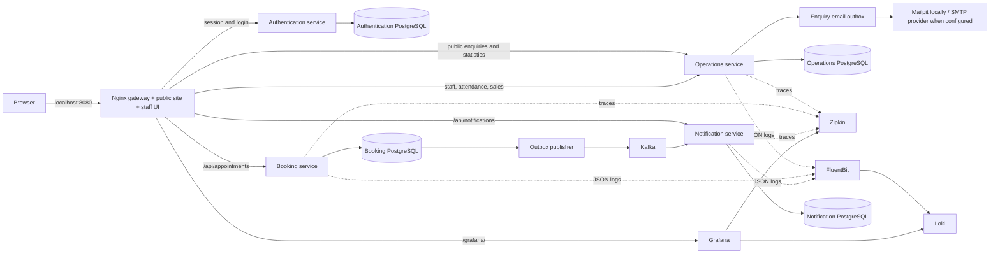

# The Ark Salon & Spa · Spa management

A spa management backend and responsive browser UI. Java 21 / Spring Boot services, PostgreSQL, Kafka, and observability run behind one gateway.

## Run locally

Install and start Docker Desktop (or Docker Engine with Compose v2). Python 3 generates local secrets once; Java, Maven and Node.js run inside containers.

```sh
git clone --branch feature/spa-management https://github.com/rajuhsharma1/hello-world.git
cd hello-world
python3 scripts/setup-security.py
docker compose up --build -d
```

If you already cloned the repository, switch to `feature/spa-management` and pull the latest changes before running Compose. First startup downloads images and Maven dependencies. Wait for the four backend services to finish starting:

```sh
docker compose logs -f booking-service notification-service gateway
```

Open **http://localhost:8080** in your local browser. Use **Staff sign in** to open the staff workspace. On first use, create your owner account using `ARK_SETUP_TOKEN` from your private `.env` file. There is no default application username or password. See [SECURITY.md](SECURITY.md) for roles, sessions and deployment settings. The public site and staff workspace share this one port:

- **Overview:** upcoming bookings and recent confirmation records.
- **Appointments:** create a future booking, search the current page, browse 50-record pages, and refresh.
- **Staff attendance:** add staff and record present, absent, or leave for a business date, with check-in/check-out and hours worked.
- **Daily sales:** register attended client visits, contact numbers, staff, amounts in INR, and UPI/cash/card payments; see daily collection totals by method.
- **Confirmations:** records saved by the notification service after Kafka processes a booking; refreshes every 10 seconds.
- **System logs:** owners and administrators can filter logs by service, level, time, message and trace ID, and read security audit events. Grafana at `/grafana/` uses its separate generated password from `.env`.

All browser API requests use relative paths on the same origin. No CORS configuration or separate frontend development server is required. The frontend uses plain HTML/CSS/JavaScript; Node is needed only for browser tests.



Only the gateway publishes a host port, bound to `127.0.0.1:8080`. PostgreSQL, Kafka, the three APIs, Grafana, Loki, and Zipkin communicate on the private Compose network. Container ports shown by `docker compose ps` without a host mapping are internal ports.

## API through the gateway

The staff API examples below require an authenticated session cookie. Mutations also require the session CSRF token and matching Origin header. Use the browser UI or the authenticated smoke-test client as a reference.

```sh
curl -i -X POST http://localhost:8080/api/appointments \
  -H 'Content-Type: application/json' \
  -d '{"customerName":"Alice","contactNumber":"+919876543210","treatment":"Massage","therapist":"Sam","startsAt":"2030-01-01T10:00:00Z"}'
curl http://localhost:8080/api/appointments
curl http://localhost:8080/api/notifications
```

| Path | Purpose |
| --- | --- |
| `POST /api/appointments` | Create a future booking; 201 on success, 400 for invalid input, 409 for the same therapist and start instant. |
| `GET /api/appointments?page=0` | Up to 50 bookings per page, sorted by start time. |
| `GET /api/appointments/{id}` | Read a booking or return 404. |
| `GET /api/notifications` | Latest 50 persisted confirmations. |
| `/ops/booking/health`, `/ops/notification/health` | Backend health through the gateway. |
| `/ops/zipkin/api/v2/…` | Zipkin API, used by smoke tests. |
| `/ops/loki/loki/api/v1/…` | Loki API, used by smoke tests. |
| `/grafana/` | Logs and tracing UI. |
| `GET/POST /api/staff` | List or add staff (name and role). |
| `GET /api/attendance?date=YYYY-MM-DD` | Attendance recorded for a day. Unmarked staff remain distinct from absent staff. |
| `PUT /api/attendance` | Save/update one record per staff member and day: `staffId`, `day`, `status`, `checkIn`, `checkOut`. |
| `GET /api/sales?date=YYYY-MM-DD&page=0` | 50-row client register plus complete daily totals and `hasNext`. |
| `POST /api/sales` | Record an attended visit and payment. Fields: `requestId` (UUID), `day`, `customerName`, `contactNumber`, `treatment`, `staffId`, `amount`, `paymentMethod` (`UPI`, `CASH`, `CARD`). |
| `GET /api/operations/settings` | Current salon business date, time zone and INR currency. |
| `/ops/operations/health` | Staff/sales service health. |

UI dates display in the browser's local time zone and are submitted as UTC instants. Overview counts and appointment search apply to the **current page**, not the whole database. The UI treatment choices are suggestions; therapist and treatment names remain free text in the API. The confirmation service stores records, without sending SMS.

## Checks

On a disposable test deployment only, run `python3 scripts/bootstrap-test-user.py` to create a random test owner. On an existing deployment, provide `ARK_TEST_USERNAME` and `ARK_TEST_PASSWORD` for an authorized test account instead. Tests create sample business records. With Python 3 installed, run:

```sh
python3 scripts/smoke.py
python3 scripts/operations-smoke.py
python3 scripts/administration-smoke.py
python3 scripts/security-smoke.py
```

It checks the UI and backend health through port 8080, creates and reads a booking, verifies a duplicate returns 409, waits for the Kafka confirmation, checks a trace with a notification consumer span, and finds the appointment log in Loki. Every run creates one test booking. `SPA_BASE_URL` can override the gateway origin.

With Node.js 22+ for browser tests:

```sh
npm ci --prefix ui
npx --prefix ui playwright install chromium
npm test --prefix ui
```

Browser tests exercise bookings with contact numbers, confirmations, duplicate errors, partial outages, safe text rendering, mobile/keyboard controls, staff attendance updates, and client entries using all three payment methods. If using an existing Chromium install, set `PLAYWRIGHT_CHROMIUM_EXECUTABLE_PATH` to its executable path. CI builds all images and runs both smoke and browser tests.

For backend unit tests with Java 21 and Maven 3.9+: `mvn verify`.

## Optional host Java development

The default workflow above uses one published port. `compose.host.yml` is an explicit debugging override that publishes database/Kafka/observability ports so host Java processes can reach them; do not combine it with the normal one-port deployment.

```sh
mkdir -p .runtime/logs
docker compose -f compose.yml -f compose.host.yml up -d booking-db notification-db kafka zipkin loki fluent-bit grafana
LOGGING_FILE_NAME="$PWD/.runtime/logs/booking.log" mvn -pl booking-service spring-boot:run
# In another terminal:
LOGGING_FILE_NAME="$PWD/.runtime/logs/notification.log" mvn -pl notification-service spring-boot:run
```

This optional backend debugging workflow has no gateway and occupies port 8080 with the booking process. Stop those host processes before running the normal full Compose stack. Use the existing checkout for cloud tasks; no extra worktree is required.

Override `DB_URL`, `DB_USER`, `DB_PASSWORD`, `KAFKA_BOOTSTRAP_SERVERS`, `ZIPKIN_ENDPOINT`, and `TRACING_SAMPLE_RATE` when running services directly. Flyway versions each schema and Hibernate validates it. Sampling defaults to 100% for development. W3C trace context persists in the booking outbox and propagates via Kafka headers to the notification listener.

For a corporate/cloud network proxy, Docker builds support optional BuildKit secrets named `maven_settings` (Maven settings.xml) and `java_truststore` (trusted Java CA store). Supply them in a private Compose override under each service's `build.secrets`; do not commit credentials, disable TLS verification, or bake proxy settings into application images. A build-only `extra_hosts` entry may be needed if your environment's proxy hostname cannot resolve inside Docker. Standard local builds need none of these overrides.

## Development scope and operations

This is an authenticated local development deployment. Customer accounts, catalog management, refunds, cancellations, payroll processing, and SMS delivery are not implemented. Salary/CTC structures and print-ready documents are available; they are not automated payroll. Scheduling prevents identical start times, not overlapping intervals. Do not expose APIs or observability endpoints publicly. The default PostgreSQL password and plaintext Kafka are for isolated development. Grafana receives a generated password; existing installations require an explicit password reset. Override `DB_PASSWORD` and `GRAFANA_PASSWORD` in an ignored `.env` before first startup if desired. Existing database passwords require an explicit database-user update or new development volumes.

The booking and outbox insert share a transaction. The publisher retries pending events after Kafka failures. Delivery is at least once; a crash between sending and marking sent can cause duplicates. Notification inserts use a unique appointment ID with `ON CONFLICT DO NOTHING`. Malformed events retry indefinitely and require operator intervention. Run one booking-service instance; multiple publishers need database claiming/locking. Long-running deployments need sent-outbox retention.

The development Kafka topic has three partitions and one replica. Event payloads contain contact numbers, requiring production access controls, encryption, and retention. Application event logs omit customer names and contact numbers. Log files rotate with Spring Boot's default rolling policy. Fluent Bit has no persistent tail cursor and may duplicate logs after a restart. Zipkin traces are ephemeral; database, Kafka, Loki and Grafana data use Docker volumes. Live processes do not survive cloud environment restarts.

```sh
docker compose down       # stop, retain data
docker compose down -v    # DELETE all development data
```


## Staff attendance and sales rules

Add staff from **Staff attendance → Add staff** before recording their attendance or sales. Each staff member has a stable ID; equal names do not merge staff. Select the business date, then **Mark** or **Update**. Present staff require a check-in. Check-out is optional until the shift ends and must be later on the same day. Absent/leave records have no working times. Hours are elapsed time without break deductions; this is attendance monitoring, not payroll.

The salon business time zone defaults to **Asia/Kolkata** (`SPA_ZONE` in Compose). Attendance times are salon-local; appointment times continue to display in the browser's local time zone. Registers accept today or past dates, not future entries. A sales entry represents one attended client visit, including walk-ins; appointments do not automatically count as attended or paid. Choose the staff member, enter the service and amount received, and choose UPI, cash or card. Payment recording does not initiate any charge. Amounts must be positive with at most two decimal places. Totals include every entry for the chosen date, across all pages, and remain separated by payment method. INR is the register currency.

Each sale uses a request UUID to prevent the same submission from being recorded twice. Replaying the same UUID/details returns the saved entry; different details with that UUID return 409. Sales are append-only in this version; edits, refunds, split payments and reconciliation are not implemented. Day/month/year CSV export is available under Reports & exports. A customer can have multiple legitimate visits, so the client count is a count of attended visits rather than unique people.

## Upgrade existing installations

Pull the branch and run `docker compose up --build -d`. Flyway automatically adds contact-number columns and the new operations database schema; **do not delete volumes to upgrade**. Appointments and confirmations now expose `contactNumber`, with 7–15 digits and an optional leading `+` for new records. Email fields are removed from the forms, active API models, and new events. Earlier records show **Not recorded** because their contact numbers are unknown. Historical email columns remain private in existing databases so the upgrade does not destroy previously collected data; they are not used for new entries. The Kafka consumer also accepts pending older events without a contact number.

## Staff records, contracts and salary structures

Open **Staff records**, choose an employee, and use **Edit staff details** to update their name, role, contact number, address or joining date. Existing attendance and sales retain the same staff ID. Saved contracts and salary structures preserve employee-name snapshots so later profile edits do not silently rewrite historical documents.

**Add contract** creates a versioned English employment draft configured for **Punjab, India**, with employer/establishment reference, workplace and employee address/contact, employment dates/type, probation, notice, working hours/breaks/overtime, weekly rest, leave, remuneration, statutory-benefit applicability, termination/grievance and confidentiality terms. Required terms are entered by the user. No current minimum-wage rates, EPF/ESI eligibility, leave quotas or other statutory entitlements are inferred. Mandatory rights prevail over conflicting draft terms. Contracts remain marked **DRAFT — FOR LOCAL LEGAL REVIEW**; have a qualified Punjab adviser review current applicable laws/notifications and the establishment's circumstances before signing or using them. The app does not certify legal compliance or provide a substitute for legal advice.

**Add salary structure** stores a dated version with annual CTC, monthly basic, HRA, allowances, employer contributions, employee deductions and annual bonus:

- Annual CTC = 12 × (basic + HRA + allowances + employer contributions) + annual bonus.
- Monthly gross = basic + HRA + allowances.
- Indicative monthly take-home = gross − employee deductions.
- Employer contributions are part of CTC and do not reduce take-home. Contributions and deductions must be entered using verified applicable amounts; tax or statutory rates are not calculated.

CTC must match the components exactly, monthly gross must be positive, and deductions cannot exceed gross. Salary documents are structures, not payslips or proof of payment. New versions preserve historical structures; lists are sorted by effective date and can include future proposals.

Contracts and salary structures have **Download PDF** and **Open / print PDF** actions. The latter opens the browser PDF viewer, where you can print. Documents include version/staff references and blank signature/acknowledgement spaces. PDFs use bundled DejaVu Sans with its included licence. English/Latin-script documents and the INR rupee symbol are tested; unsupported characters return an explicit error instead of silently changing names. No Punjabi-language legal translation or shaping is provided.

## Daily expenses, exports and monthly profit/loss

Use **Expenses** to record amounts actually paid under RENT, SALARY, UTILITIES, SUPPLIES, MAINTENANCE or OTHER, with a description and UPI/cash/card payment method. The date must be today or a past salon business date. Daily totals include every page; expense entries are append-only and use request IDs to avoid duplicate submissions. To include payroll in profit/loss, record actual paid payroll once as a SALARY expense. Saving a CTC/salary structure does **not** automatically book an expense.

Use **Reports & exports** to download **day, month or calendar-year sales CSVs**, including all matching records rather than the visible 50-row page. CSVs are UTF-8 with a BOM for spreadsheet compatibility, quote embedded commas/quotes/newlines, preserve phone numbers as text, and neutralize formula-leading cells. Phone strings may include a leading spreadsheet apostrophe in raw CSV readers. The selected year is a calendar year, not the Indian financial year.

The monthly profit/loss report uses **recorded sales collections − recorded expenses**. It shows category totals, revenue, expenses and operating profit/loss, with download and print-ready PDF actions. This is a management cash-based summary, not audited accounts or a statutory tax return. Refunds, outstanding payments, taxes, inventory, depreciation and accrual adjustments are not calculated. Do not deduct saved CTC budgets as well as actual payroll expenses.

## Emergency and maintenance contacts

Use **Emergency contacts** to add or update electricians, plumbers, AC technicians, medical, security and other contacts. Store the name/trade, primary and optional secondary phone, service area/address and notes. Phone links open the device dialler. Contact numbers accept 3–15 digits (optional leading `+`) to accommodate short emergency numbers; employee/client contact fields still require 7–15 digits. The directory is manually maintained and does not verify service availability.

## Additional API endpoints and checks

- `PUT /api/staff/{id}` updates profile fields.
- `GET/POST /api/contracts` and `GET/POST /api/salaries` list/create versions; list requests require `staffId`.
- `/api/contracts/{id}/pdf` and `/api/salaries/{id}/pdf` return inline printable PDFs; add `?download=true` for downloads.
- `GET /api/expenses?date=YYYY-MM-DD&page=0` and `POST /api/expenses` list/create paid expenses.
- `GET/POST /api/contacts`, `PUT/DELETE /api/contacts/{id}` manage the directory.
- `/api/reports/sales.csv?period=DAY|MONTH|YEAR&date=YYYY-MM-DD` exports a complete period.
- `/api/reports/profit-loss?date=YYYY-MM-DD` returns the selected calendar month's recorded result; `/api/reports/profit-loss.pdf?date=YYYY-MM-DD&download=true` downloads its PDF.

Run `python3 scripts/administration-smoke.py` after the existing smoke checks. It intentionally creates HR test records, expenses, 52 test sales and a next-month boundary sale on historical dates to verify complete CSV exports and exact P&L changes. Eight Playwright tests now include the HR/finance/directory workflows. Sixteen backend tests cover outbox/attendance, CTC validation, calendar boundaries, CSV escaping and multi-page PDF content.

The app still publishes only port **8080**. Pull, run `python3 scripts/setup-security.py`, then `docker compose up --build -d` to apply the new Flyway migration; do not delete database volumes. Profiles, salary/contract PDFs and CSVs contain confidential information. Access requires a role-protected account. The default deployment remains loopback-only; configure HTTPS, backups and production credentials before shared use.

## Venue styling and supplied images

The UI uses the supplied Ark sign and reception/treatment-room photos as references for deep navy, cyan, white and warm wood styling. `ui/assets/ark-logo.png` is an AI-assisted reconstruction of the photographed sign, and `ark-venue.png` is an adapted two-photo venue diptych; they are not original master assets or unmodified Google Maps photos. Source notes are in `ui/assets/SOURCES.md`. The overview includes the supplied Kharar address and a Google Maps search link. The listing could not be fetched from the cloud environment, so no additional Google images, live review counts or current opening hours are asserted.

## Public website, enquiries and statistics

The gateway homepage `/` now serves the visitor website; staff sign in at `/login.html` and work in `/index.html`. Existing bookmark hashes should move from `/#sales` to `/index.html#sales`. Everything still uses the same gateway port.

The visitor site includes salon/spa service enquiries, a careers questionnaire with optional PDF resume (maximum 5 MB), contact enquiries, complaints and the Ark journal. Enquiries are stored in PostgreSQL and given a reference; a booking enquiry is **not** a confirmed appointment. Public writes enforce the configured Origin, a custom request header, field validation, consent, upload bounds and an IP rate limit. Uploaded resumes remain private and are downloadable only as attachments by authorised managers. The public hero is clearly labelled illustrative; the venue section uses the previously adapted supplied references. In **Website & enquiries**, managers can set an optional HTTPS video URL for media they have permission to publish; otherwise the hero image remains.

Owners and administrators can review enquiries, change OPEN / IN_REVIEW / RESOLVED status, download resumes, publish/unpublish plain-text journal posts, change the recipient email and retry failed email deliveries. Draft posts are private. The initial recipient is `thearksalonandspa@gmail.com`; editing it affects new notifications and the public contact link. Existing queued notifications retain their destination; a failed-email retry uses the current destination.

Email notifications use a persisted outbox, with bounded retries and a visible delivery status. The default local stack sends to **Mailpit**, accessible to managers at `/mailbox/`; it does **not** deliver to Gmail. Configure `SMTP_HOST`, `SMTP_PORT`, `SMTP_FROM`, `SMTP_USERNAME`, `SMTP_PASSWORD`, `SMTP_AUTH` and `SMTP_STARTTLS` privately in `.env` for your provider, then recreate operations-service. For authenticated STARTTLS SMTP, use port 587 with auth and STARTTLS enabled and a verified sender address. SMTP credentials are never editable or displayed in the browser. A SENT state means the configured SMTP server accepted the message, not proof of external inbox delivery. Delivery is at least once, so rare duplicate notifications are possible after a process failure. Public submissions are durable even while SMTP is unavailable.

**Statistics** provides 12 monthly revenue comparisons with the previous calendar year, monthly expenses/operating results and staff client visits for a selected week, month or year. Charts have accessible numeric tables. Zero-sales months and staff are retained. Weeks run Monday–Sunday; dates follow the salon business calendar. A visit is a recorded sale entry; distinct-client counts use distinct contact numbers per employee and period. These are neither appointment counts nor a reliable measure of unique people when numbers are shared. Current partial-year totals are labelled as recorded collections, not compared with a complete previous year as a growth rate. The dashboard displays current-month collections, visits and the year's recorded revenue.

Staff contract, salary and monthly P&L PDFs now use branded layouts, structured sections, financial rows, signature lines and page totals. Staff records also offer a **combined employment and salary pack**, using the most recent saved contract and salary versions for the selected employee. Both versions must belong to the same employee. Employment terms remain editable Punjab, India drafts requiring local legal review; styling does not certify legal compliance.

On disposable test deployments, run `python3 scripts/website-smoke.py` after the existing checks. It creates sample enquiries and historical sales, verifies private resume round trips and local email capture, tests draft publishing and validates real staff calendar-period counts. It expects the local Mailpit configuration. Do not run this data-creating suite against a live salon database.
