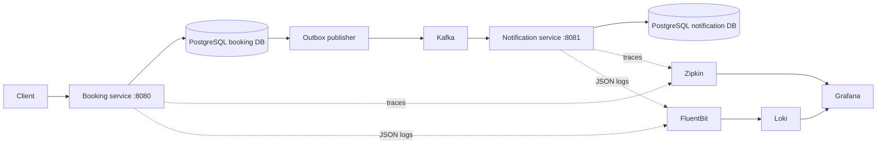

# Spa management

Java 21 / Spring Boot 3.5 microservices starter for appointment management.



## Run

Requires Docker Engine and Docker Compose v2. The image build uses Maven 3.9.9 and Java 21; no host JDK is necessary.

```sh
docker compose up --build -d
python3 scripts/smoke.py
docker compose logs -f booking-service notification-service
```

The smoke test waits for service health, creates and reads an appointment, verifies that a duplicate therapist/start time returns HTTP 409, then checks that Kafka delivery creates a notification in the second database. It also verifies a shared trace with a Kafka consumer span in Zipkin and the appointment event log in Loki. Each run creates a new appointment. Health endpoints are `/actuator/health` on ports 8080 and 8081.

Development tools: Grafana on port 3000 (user `admin`, default password `spa_dev_only`), Zipkin on 9411, Loki on 3100. In Grafana Explore select Loki and query `{job="spa"}`; JSON logs include `traceId` and `spanId` when a span is active. Select Zipkin to search traces. Traces propagate from the booking HTTP request through a persisted W3C `traceparent` in the outbox and Kafka headers to the notification listener. Sampling defaults to 100% for development; configure `TRACING_SAMPLE_RATE` for each service as needed.

All published Compose ports bind to loopback. Credentials and plaintext Kafka are for local development only. Override `DB_PASSWORD` and `GRAFANA_PASSWORD` in an ignored `.env` file before the first startup if desired. Changing PostgreSQL passwords later requires updating existing database users or recreating development volumes.

## API

```sh
curl -i -X POST http://localhost:8080/api/appointments \
  -H 'Content-Type: application/json' \
  -d '{"customerName":"Alice","customerEmail":"alice@example.com","treatment":"Massage","therapist":"Sam","startsAt":"2030-01-01T10:00:00Z"}'
curl http://localhost:8080/api/appointments
curl http://localhost:8081/api/notifications
```

- `POST /api/appointments`: validated future booking; returns 201, 400 for invalid input, 409 for the same therapist and start instant.
- `GET /api/appointments?page=0`: 50 appointments per page, sorted by start time.
- `GET /api/appointments/{id}`: returns a booking or 404.
- `GET /api/notifications`: latest 50 persisted confirmation records.

The notification service stores confirmations; it does not send email or SMS. Therapist and treatment names are free text. Scheduling currently prevents identical start times, not overlapping treatment intervals. Customer accounts, staff/catalog management, billing, cancellations, authentication, authorization, and a web frontend are future features. Do not expose these unauthenticated APIs or observability services publicly.

## Local development and tests

With Java 21 and Maven 3.9+:

```sh
mvn verify
mkdir -p .runtime/logs
docker compose -f compose.yml -f compose.host.yml up -d booking-db notification-db kafka zipkin loki fluent-bit grafana
LOGGING_FILE_NAME="$PWD/.runtime/logs/booking.log" mvn -pl booking-service spring-boot:run
# In a second terminal:
LOGGING_FILE_NAME="$PWD/.runtime/logs/notification.log" mvn -pl notification-service spring-boot:run
```

Services use PostgreSQL on localhost ports 5432 and 5433, and Kafka on 9092. Override `DB_URL`, `DB_USER`, `DB_PASSWORD`, `KAFKA_BOOTSTRAP_SERVERS`, and `ZIPKIN_ENDPOINT` as needed. Flyway creates and versions each service's schema; Hibernate validates it. No shared tables or cross-service database queries are used.

When using a network proxy, configure Maven's supported `settings.xml` proxy settings; Java/Maven may not consume shell proxy variables. Keep credentials out of the repository. Use the existing checkout in cloud tasks; no extra worktree is required.

## Delivery and operational limits

The booking and outbox insert share one transaction. The publisher retries pending events after Kafka failures. Delivery is at least once: a crash between sending and marking an event can produce duplicates. The notification insert uses a unique appointment ID and `ON CONFLICT DO NOTHING` for idempotency. Failed listener processing retries indefinitely without advancing past the failed record; malformed events require operator intervention. Run one booking-service instance with this initial outbox publisher; multiple publishers require database claiming/locking. Sent outbox records need a retention policy for long-running deployments.

Kafka topic `spa.appointments.v1` has three partitions and one replica for the single development broker. Event payloads contain customer email addresses, so production needs encryption, access controls, and retention policies. Application event logs intentionally omit customer names and email addresses. Structured file logs rotate with Spring Boot's default rolling policy; the development Fluent Bit configuration has no persistent tail cursor, so collector restarts can duplicate logs. Zipkin trace storage is ephemeral; databases, Kafka, Loki and Grafana use Docker volumes.

```sh
docker compose down       # stop, retain data
docker compose down -v    # DELETE all development data
```
