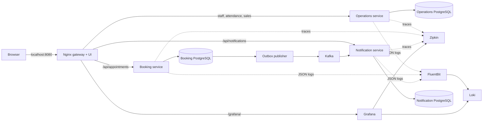

# The Ark Salon & Spa · Spa management

A spa management backend and responsive browser UI. Java 21 / Spring Boot services, PostgreSQL, Kafka, and observability run behind one gateway.

## Run locally

Install and start Docker Desktop (or Docker Engine with Compose v2). No host Java, Maven, Node.js, or Python is needed just to run the app.

```sh
git clone --branch feature/spa-management https://github.com/rajuhsharma1/hello-world.git
cd hello-world
docker compose up --build -d
```

If you already cloned the repository, switch to `feature/spa-management` and pull the latest changes before running Compose. First startup downloads images and Maven dependencies. Wait for all three backend services to finish starting:

```sh
docker compose logs -f booking-service notification-service gateway
```

Open **http://localhost:8080** in your local browser. Everything you need goes through this one port:

- **Overview:** upcoming bookings and recent confirmation records.
- **Appointments:** create a future booking, search the current page, browse 50-record pages, and refresh.
- **Staff attendance:** add staff and record present, absent, or leave for a business date, with check-in/check-out and hours worked.
- **Daily sales:** register attended client visits, contact numbers, staff, amounts in INR, and UPI/cash/card payments; see daily collection totals by method.
- **Confirmations:** records saved by the notification service after Kafka processes a booking; refreshes every 10 seconds.
- **Logs & traces:** the sidebar opens Grafana at `/grafana/`. Development login: `admin` / `spa_dev_only`. Select Loki in Explore and query `{job="spa"}`; select Zipkin to search traces.

All browser API requests use relative paths on the same origin. No CORS configuration or separate frontend development server is required. The frontend uses plain HTML/CSS/JavaScript; Node is needed only for browser tests.



Only the gateway publishes a host port, bound to `127.0.0.1:8080`. PostgreSQL, Kafka, the three APIs, Grafana, Loki, and Zipkin communicate on the private Compose network. Container ports shown by `docker compose ps` without a host mapping are internal ports.

## API through the gateway

```sh
curl -i -X POST http://localhost:8080/api/appointments \
  -H 'Content-Type: application/json' \
  -d '{"customerName":"Alice","contactNumber":"+919876543210","treatment":"Massage","therapist":"Sam","startsAt":"2030-01-01T10:00:00Z"}'
curl http://localhost:8080/api/appointments
curl http://localhost:8080/api/notifications
```

| Path | Purpose |
| --- | --- |
| `POST /api/appointments` | Create a future booking; 201 on success, 400 for invalid input, 409 for the same therapist and start instant. |
| `GET /api/appointments?page=0` | Up to 50 bookings per page, sorted by start time. |
| `GET /api/appointments/{id}` | Read a booking or return 404. |
| `GET /api/notifications` | Latest 50 persisted confirmations. |
| `/ops/booking/health`, `/ops/notification/health` | Backend health through the gateway. |
| `/ops/zipkin/api/v2/…` | Zipkin API, used by smoke tests. |
| `/ops/loki/loki/api/v1/…` | Loki API, used by smoke tests. |
| `/grafana/` | Logs and tracing UI. |
| `GET/POST /api/staff` | List or add staff (name and role). |
| `GET /api/attendance?date=YYYY-MM-DD` | Attendance recorded for a day. Unmarked staff remain distinct from absent staff. |
| `PUT /api/attendance` | Save/update one record per staff member and day: `staffId`, `day`, `status`, `checkIn`, `checkOut`. |
| `GET /api/sales?date=YYYY-MM-DD&page=0` | 50-row client register plus complete daily totals and `hasNext`. |
| `POST /api/sales` | Record an attended visit and payment. Fields: `requestId` (UUID), `day`, `customerName`, `contactNumber`, `treatment`, `staffId`, `amount`, `paymentMethod` (`UPI`, `CASH`, `CARD`). |
| `GET /api/operations/settings` | Current salon business date, time zone and INR currency. |
| `/ops/operations/health` | Staff/sales service health. |

UI dates display in the browser's local time zone and are submitted as UTC instants. Overview counts and appointment search apply to the **current page**, not the whole database. The UI treatment choices are suggestions; therapist and treatment names remain free text in the API. The confirmation service stores records, without sending SMS.

## Checks

With Python 3 installed, run the functional check against the running stack:

```sh
python3 scripts/smoke.py
python3 scripts/operations-smoke.py
```

It checks the UI and backend health through port 8080, creates and reads a booking, verifies a duplicate returns 409, waits for the Kafka confirmation, checks a trace with a notification consumer span, and finds the appointment log in Loki. Every run creates one test booking. `SPA_BASE_URL` can override the gateway origin.

With Node.js 22+ for browser tests:

```sh
npm ci --prefix ui
npx --prefix ui playwright install chromium
npm test --prefix ui
```

Browser tests exercise bookings with contact numbers, confirmations, duplicate errors, partial outages, safe text rendering, mobile/keyboard controls, staff attendance updates, and client entries using all three payment methods. If using an existing Chromium install, set `PLAYWRIGHT_CHROMIUM_EXECUTABLE_PATH` to its executable path. CI builds all images and runs both smoke and browser tests.

For backend unit tests with Java 21 and Maven 3.9+: `mvn verify`.

## Optional host Java development

The default workflow above uses one published port. `compose.host.yml` is an explicit debugging override that publishes database/Kafka/observability ports so host Java processes can reach them; do not combine it with the normal one-port deployment.

```sh
mkdir -p .runtime/logs
docker compose -f compose.yml -f compose.host.yml up -d booking-db notification-db kafka zipkin loki fluent-bit grafana
LOGGING_FILE_NAME="$PWD/.runtime/logs/booking.log" mvn -pl booking-service spring-boot:run
# In another terminal:
LOGGING_FILE_NAME="$PWD/.runtime/logs/notification.log" mvn -pl notification-service spring-boot:run
```

This optional backend debugging workflow has no gateway and occupies port 8080 with the booking process. Stop those host processes before running the normal full Compose stack. Use the existing checkout for cloud tasks; no extra worktree is required.

Override `DB_URL`, `DB_USER`, `DB_PASSWORD`, `KAFKA_BOOTSTRAP_SERVERS`, `ZIPKIN_ENDPOINT`, and `TRACING_SAMPLE_RATE` when running services directly. Flyway versions each schema and Hibernate validates it. Sampling defaults to 100% for development. W3C trace context persists in the booking outbox and propagates via Kafka headers to the notification listener.

For a corporate/cloud network proxy, Docker builds support optional BuildKit secrets named `maven_settings` (Maven settings.xml) and `java_truststore` (trusted Java CA store). Supply them in a private Compose override under each service's `build.secrets`; do not commit credentials, disable TLS verification, or bake proxy settings into application images. A build-only `extra_hosts` entry may be needed if your environment's proxy hostname cannot resolve inside Docker. Standard local builds need none of these overrides.

## Development scope and operations

This is an unauthenticated local development starter, not a production deployment. Customer accounts, catalog management, authentication, refunds, cancellations, payroll, and SMS delivery are not implemented. Scheduling prevents identical start times, not overlapping intervals. Do not expose APIs or observability endpoints publicly. Default PostgreSQL/Grafana passwords and plaintext Kafka are for isolated development. Override `DB_PASSWORD` and `GRAFANA_PASSWORD` in an ignored `.env` before first startup if desired. Existing database passwords require an explicit database-user update or new development volumes.

The booking and outbox insert share a transaction. The publisher retries pending events after Kafka failures. Delivery is at least once; a crash between sending and marking sent can cause duplicates. Notification inserts use a unique appointment ID with `ON CONFLICT DO NOTHING`. Malformed events retry indefinitely and require operator intervention. Run one booking-service instance; multiple publishers need database claiming/locking. Long-running deployments need sent-outbox retention.

The development Kafka topic has three partitions and one replica. Event payloads contain contact numbers, requiring production access controls, encryption, and retention. Application event logs omit customer names and contact numbers. Log files rotate with Spring Boot's default rolling policy. Fluent Bit has no persistent tail cursor and may duplicate logs after a restart. Zipkin traces are ephemeral; database, Kafka, Loki and Grafana data use Docker volumes. Live processes do not survive cloud environment restarts.

```sh
docker compose down       # stop, retain data
docker compose down -v    # DELETE all development data
```


## Staff attendance and sales rules

Add staff from **Staff attendance → Add staff** before recording their attendance or sales. Each staff member has a stable ID; equal names do not merge staff. Select the business date, then **Mark** or **Update**. Present staff require a check-in. Check-out is optional until the shift ends and must be later on the same day. Absent/leave records have no working times. Hours are elapsed time without break deductions; this is attendance monitoring, not payroll.

The salon business time zone defaults to **Asia/Kolkata** (`SPA_ZONE` in Compose). Attendance times are salon-local; appointment times continue to display in the browser's local time zone. Registers accept today or past dates, not future entries. A sales entry represents one attended client visit, including walk-ins; appointments do not automatically count as attended or paid. Choose the staff member, enter the service and amount received, and choose UPI, cash or card. Payment recording does not initiate any charge. Amounts must be positive with at most two decimal places. Totals include every entry for the chosen date, across all pages, and remain separated by payment method. INR is the register currency.

Each sale uses a request UUID to prevent the same submission from being recorded twice. Replaying the same UUID/details returns the saved entry; different details with that UUID return 409. Sales are append-only in this version; edits, refunds, split payments, CSV export and reconciliation are not implemented. A customer can have multiple legitimate visits, so the client count is a count of attended visits rather than unique people.

## Upgrade existing installations

Pull the branch and run `docker compose up --build -d`. Flyway automatically adds contact-number columns and the new operations database schema; **do not delete volumes to upgrade**. Appointments and confirmations now expose `contactNumber`, with 7–15 digits and an optional leading `+` for new records. Email fields are removed from the forms, active API models, and new events. Earlier records show **Not recorded** because their contact numbers are unknown. Historical email columns remain private in existing databases so the upgrade does not destroy previously collected data; they are not used for new entries. The Kafka consumer also accepts pending older events without a contact number.
