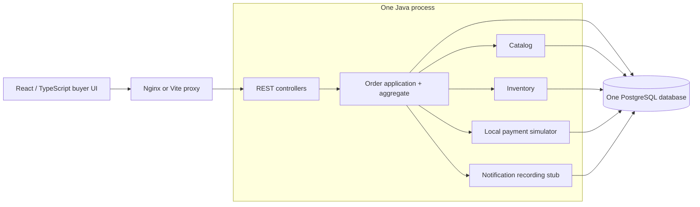

# Enterprise Commerce Architecture Lab — Phase 4

A runnable architecture learning project: browse three products, submit a single-product order, simulate payment approval or decline, and reload persisted order status/history. It lives beside the existing Ark application; it does not replace or reuse that application's services, accounts or database.

The supplied **Bebo Codex Master Prompt** and **Architecture Interview Blueprint** are reference material. The commerce domain and stack are proposed learning exercises, not requirements attributed to the employer. This delivery includes Phase 2 database/import experiments, Phase 3 service extraction and Phase 4 durable events, autonomous execution and asynchronous reporting. Authentication and cloud operations remain later milestones.

## Start Phase 4: Kafka, durable Saga and asynchronous reporting

With Docker Desktop running, from the cloned repository root in PowerShell:

```powershell
git fetch origin
git switch feature/ecal-phase-4
cd ecal
docker compose -f compose.phase4.yaml up --build --wait --wait-timeout 240
```

Open **http://localhost:8095**. An order is accepted durably, completed by a background worker, and projected into the reporting database. Inventory and Payment commands use the existing idempotent HTTP contracts; Kafka carries activation and outcome facts. The UI labels pending status and reporting delay explicitly. This stack uses fresh isolated volumes; Phase 3 data is preserved separately. For limited resources, add `-f compose.phase4.compact.yaml` after the first `-f` argument; it retains four database owners in one PostgreSQL instance. Use that file selection consistently, as explained in the guide.

Read the [step-by-step Windows/IntelliJ and failure guide](docs/learning/PHASE-04.md), [HLD](docs/architecture/PHASE-04-HLD.md), [LLD](docs/architecture/PHASE-04-LLD.md), [event contracts](contracts/events/README.md), [ADR 021](docs/adr/ADR-021-event-driven-execution.md) and [validation](VALIDATION.md). Stop using `docker compose -f compose.phase4.yaml down`; no `-v`, so data is retained. This remains a local learning app with simulated payments and a shared buyer.

## Start Phase 3: three services, one browser port

Orders, Inventory and simulated Payment now have independent database ownership, versioned HTTP contracts, persisted workflow progress and identity-safe recovery after timeouts. The Phase 2 monolith remains runnable at 8090; the new stack uses 8091 with separate volumes. Fresh startup does not silently migrate old data.

From your cloned repository root, with Docker Desktop running (PowerShell works; Make is not required):

```powershell
git fetch origin
git switch feature/ecal-phase-3
cd ecal
docker compose -f compose.phase3.yaml up --build --wait --wait-timeout 180
```

Open **http://localhost:8091**. Read the [Phase 3 mentoring/IntelliJ guide](docs/learning/PHASE-03.md), [HLD](docs/architecture/PHASE-03-HLD.md), [LLD](docs/architecture/PHASE-03-LLD.md), [offline migration runbook](docs/runbooks/PHASE-03-MIGRATION.md) and [observed validation](VALIDATION.md). `python scripts/phase3_failure_lab.py` demonstrates a real payment-service outage and same-key recovery. Normal `docker compose -f compose.phase3.yaml down` preserves the three volumes.

CSV import stays in the monolith: its original shared transaction cannot be transferred across HTTP unchanged. Phase 3 has no real payments, sign-in, autonomous background recovery, Kafka or cloud deployment. Those limitations and their reasons are explicit in the guide.

## Preserved Phase 2 baseline

## What changed in Phase 2

Cursor-paged catalog and filtered order history, explicit SQL read projections and indexes, bounded create-only CSV imports with per-batch rollback and safe replay, and a reproducible measured query experiment. Read the [Phase 2 mentoring guide](docs/learning/PHASE-02.md), [performance results](tests/performance/REPORT.md), and [observed validation](VALIDATION.md). The previous `feature/ecal-phase-1` branch remains the transactional baseline.

## Run the Phase 2 monolith

**Docker-only route — Windows, macOS and Linux:** install [Docker Desktop](https://www.docker.com/products/docker-desktop/) (or Docker Engine with Compose v2 on Linux) and keep it running. Java, Maven, Node and Make are not required on your computer for this route.

In a terminal opened in your cloned `hello-world` repository, select the lab branch and enter its directory:

```sh
git fetch origin
git switch feature/ecal-phase-2
cd ecal
```

If you are already inside `ecal`, do not run `cd ecal` again. This folder contains **`compose.yaml`**; the repository root contains the separate Ark application's `compose.yml`.

Check Docker and start the application:

```sh
docker compose version
docker compose -f compose.yaml up --build --wait --wait-timeout 180
```

Open `http://localhost:8090`. First startup downloads images/dependencies, compiles Java/TypeScript and runs migrations. Only this loopback port is published. PostgreSQL is private and orders survive normal restarts.

### Windows PowerShell

The error **“The term 'make' is not recognized”** means Make is not installed. Use the Docker commands above directly; Make is an optional shortcut. The supplied Makefile also expects Bash, so installing only a Windows Make executable is unnecessary for Docker startup.

1. Open Docker Desktop and wait until its engine is running. Use Linux containers.
2. Open PowerShell in the `ecal` folder. `Get-ChildItem compose.yaml` should show the lab's Compose file.
3. Run `docker compose -f compose.yaml up --build --wait --wait-timeout 180`.
4. Open `http://localhost:8090` in your browser.

If PowerShell also cannot find `docker`, install Docker Desktop and reopen PowerShell. If Docker cannot connect to its engine, start Docker Desktop and complete any WSL2 setup it requests. An “unknown flag” for `--wait` or `--wait-timeout` means Docker Compose needs updating.

Useful commands from `ecal/`:

```sh
docker compose -f compose.yaml ps
docker compose -f compose.yaml logs --tail=80 api db web
docker compose -f compose.yaml down
```

Normal `down` preserves the database. Do not add `-v` unless deliberately discarding the lab data. On systems with GNU Make and Bash, `make up`, `make logs` and `make down` remain equivalent shortcuts.

All payments and notification records are **simulated**. Every browser shares one server-assigned demo buyer; there is no authentication or owner isolation yet. Keep this lab on loopback and use synthetic data only. This is not a production deployment or a real store.

### Host development route

Use **Java 21**, **Maven 3.9+**, **Node 24.19.0** (tested; supported ranges are in `frontend/package.json`), and Docker. Install dependencies once:

```sh
make install
make dev-db
```

In separate terminals in `ecal/`:

```sh
make dev-backend    # Java backend: 127.0.0.1:8090
```

```sh
make dev-frontend   # Vite UI: 127.0.0.1:5173, proxies /api to the backend
```

Open `http://localhost:5173`. Run `make down` before switching from the full Docker stack to host development because both modes use port 8090. The development database is bound to `127.0.0.1:5544`; both modes share ECAL's own persistent volume. Do not run `docker compose down -v` unless deliberately discarding this lab's data. `ECAL_DB_PASSWORD` must match the database's existing user password; editing an environment file does not rotate it.

## Prove the slice

With Java/Maven, Node and Docker available:

```sh
npm ci --prefix frontend
make verify
```

`mvn verify` runs domain/architecture unit tests and **real PostgreSQL 17.6 Testcontainers integration tests**. It fails if Docker is unavailable; it does not silently substitute H2 or skip concurrency tests. Frontend checks run Vitest/React Testing Library and strict TypeScript/Vite production compilation. `mvn test` alone runs only the unit/architecture tier.

With the app running:

```sh
make smoke
npx --prefix frontend playwright install chromium
make e2e
```

For host development, use `ECAL_WEB_URL=http://127.0.0.1:5173 make e2e`. To use an existing Chromium, set `PLAYWRIGHT_CHROMIUM_EXECUTABLE_PATH` to its executable. Smoke/E2E checks create synthetic orders and consume a little demo stock; integration tests use a separate disposable database and do not modify your running lab.

Useful targeted proof:

```sh
cd backend/modular-monolith
mvn verify -Dit.test=CheckoutIntegrationTestIT#concurrentDistinctOrdersCannotOversellTheLastUnit
mvn verify -Dit.test=CheckoutIntegrationTestIT#concurrentSameKeyHasOneCommitAndSevenExactReplays
```

See [VALIDATION.md](VALIDATION.md) for actual observed runs and limitations. NFR targets in the discovery documents are **design proposals**, not measured SLAs or benchmark claims.

## Architecture: why these choices now?



| Choice | Reason and alternative | Cost / revisit trigger |
|---|---|---|
| Java 21 + Spring Boot 4.1.1 | Mature transactions, validation and HTTP infrastructure; actual artifacts/build verified. Java 17/Boot 3.5 are realistic alternatives, not silently assumed equivalents. | Framework conventions/proxy behavior require tests. Revisit release/support compatibility during upgrades. |
| Modular monolith | Domain boundaries without network failure and deployment overhead on day one. Microservices are a later comparison. | One deployment and one local transaction; extraction must replace that consistency model. |
| PostgreSQL + Flyway + Spring JDBC | Real database locking and constraints are visible in SQL. H2 differs from PostgreSQL; JPA adds mapping/flush behavior this small slice does not need. | Explicit mappings and SQL; adopt richer persistence patterns when justified. |
| REST + checked-in OpenAPI | Four small, explicit operations with stable error semantics. GraphQL/BFF solve later aggregate query needs, not today's checkout. | Contract synchronization must be tested/reviewed; no generated Swagger UI claimed. |
| React + TypeScript, local hooks | Components own presentation; the app coordinates the small journey. Session storage preserves an uncertain checkout, not sensitive credentials. | No cross-tab buyer identity and no general cache. Add RTK Query when shared server state warrants it. |
| One transaction + atomic conditional stock update | A database row lock and predicate serialize last-unit competition across application instances. Java `synchronized` cannot protect another process. | Hot products serialize; measured contention may justify later reservation architecture. |
| Local payment/notification ports | Deterministic learning without real money or email. Their SQL effects roll back with the order. | This is not a model of remote payment timeout/reconciliation. Extraction needs explicit new decisions. |

Every substantial decision has WHAT/WHY/alternatives/trade-offs/failure/proof in the [decision log](docs/DECISION_LOG.md). [Configuration decisions](docs/architecture/CONFIGURATION.md) explain the concrete pool, timeout, binding, proxy and readiness settings. **Outbox, Kafka, Saga, CQRS, Redis, identity and AWS ADRs are deferred proposals, not implemented capabilities.**

## Walkthrough: defend the transaction at a whiteboard

1. `CatalogController` lists a bounded page of products and makes one bounded inventory lookup. Displayed availability is advisory; the checkout write is authoritative.
2. `OrderController` validates the UUID `Idempotency-Key`, product UUID, quantity 1–10 and fake payment choice. Clients cannot set price. Errors use `application/problem+json` with a machine-readable `code`.
3. `CheckoutService` enters a **READ COMMITTED local transaction** through a Spring proxy. It first checks for a committed replay. A new order snapshots the catalog price; `JdbcOrderStore` claims the buyer/key using a unique constraint and `ON CONFLICT DO NOTHING`.
4. A competing request with the same key waits for the winner's transaction. Its next SQL statement sees the committed result, compares the original business payload, and returns that result (`200`) or a conflict (`409`). New orders return `201`. Timestamp precision is normalized to PostgreSQL microseconds so replay/status responses remain equal.
5. `JdbcInventory` executes `UPDATE ... SET available=available-? WHERE available>=?`. A zero-row result is a stock conflict. Neither an order claim nor payment survives that rollback. The order aggregate allows only PENDING → RESERVED → CONFIRMED, or RESERVED → CANCELLED.
6. The local simulator records AUTHORIZED/DECLINED. Approval consumes stock; decline releases it and persists CANCELLED. `RecordingNotifications` writes a local record. All writes commit together. A deterministic late-notification failure test proves that stock, order and simulated payment roll back together.
7. The UI displays the returned status and reads persisted history. If a response is lost or a server outcome is uncertain, it preserves the **same UUID and exact payload**, including across reload, and offers a safe retry. History shows the latest 50 orders for the shared demo buyer.

Important: `@Transactional` works through advised, non-final Spring beans, not arbitrary self-invocation. Inventory/payment/notification mutations use `MANDATORY` propagation to reject accidental calls without checkout's transaction. The domain aggregate remains framework-free and final. [LLD](docs/architecture/LLD.md) includes sequences, data and failure paths.

## API examples

```sh
curl http://localhost:8090/api/catalog/products
curl -i http://localhost:8090/api/orders \
  -H 'Content-Type: application/json' \
  -H 'Idempotency-Key: 20000000-0000-0000-0000-000000000001' \
  -d '{"productId":"10000000-0000-0000-0000-000000000001","quantity":1,"paymentOutcome":"APPROVE"}'
curl http://localhost:8090/api/orders
```

Repeating that exact POST returns the original result with `200`; changing quantity under the same key returns `409`. A new logical purchase needs a new UUID. Validation/insufficient-stock requests that roll back have no committed result to replay. The HTTP/OpenAPI contract is [commerce.yaml](contracts/openapi/commerce.yaml).

## Read in this order

1. [Product, requirements and acceptance criteria](docs/requirements/PRODUCT_AND_REQUIREMENTS.md)
2. [Quality attribute scenarios / NFR scorecard](docs/requirements/QUALITY_SCENARIOS.md)
3. [Threat model and risk register](docs/requirements/THREATS_AND_RISKS.md)
4. [HLD](docs/architecture/HLD.md) → [LLD](docs/architecture/LLD.md)
5. [Architecture decisions](docs/DECISION_LOG.md) → [requirements-to-test traceability](docs/TRACEABILITY_MATRIX.md)
6. [Phase 0 mentoring checkpoint](docs/learning/PHASE-00.md) → [Phase 1 walkthrough/exercises](docs/learning/PHASE-01.md) → [Phase 2 data/performance](docs/learning/PHASE-02.md) → [Phase 3 extraction/recovery](docs/learning/PHASE-03.md)
7. [Eight-phase roadmap](docs/architecture/ROADMAP.md) and [local runbook](docs/runbooks/LOCAL_DEVELOPMENT.md)

### Interview checkpoint

- **Why not microservices yet?** Business boundaries do not imply deployment boundaries. Prove the invariants with local ACID first, then compare the coordination cost of extraction.
- **Does idempotency mean exactly-once delivery?** No. Requests may repeat; a database constraint plus payload comparison gives one committed local business result per buyer/key.
- **Why is a payment timeout different from decline?** A remote provider may have succeeded. This local simulator has no remote timeout; Phase 4 needs idempotent provider operations and reconciliation, not blind retries or invented failure semantics.
- **What proves no overselling?** The SQL predicate plus an eight-request real-PostgreSQL race: exactly one purchase of the last unit, seven stock conflicts, zero negative inventory.

Exercise: run a decline, replay its key, then change its quantity. Predict order/payment/stock rows before each request, prove the prediction, and explain why the same algorithm would not make an external payment atomic with PostgreSQL.

## Next small milestone

Phase 3 is implemented beside the preserved monolith. Next is Phase 4 event-driven workflow execution with an outbox/relay and consumer deduplication. Keep identities, compensation and unknown-outcome semantics intact while changing delivery/execution.
