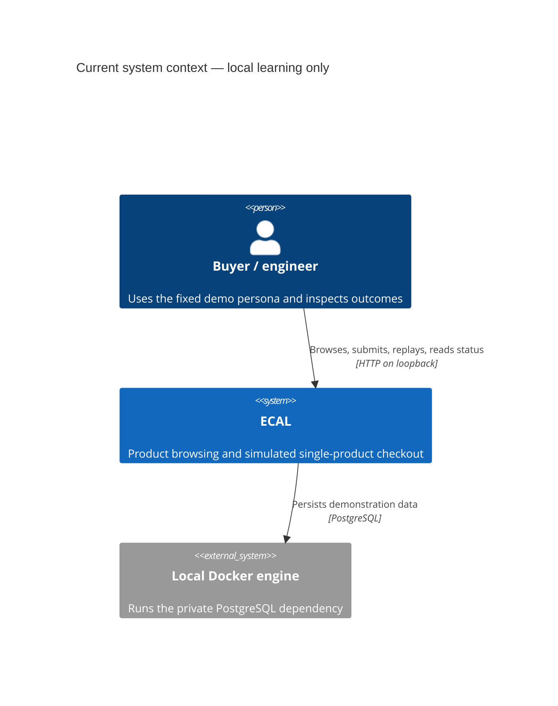
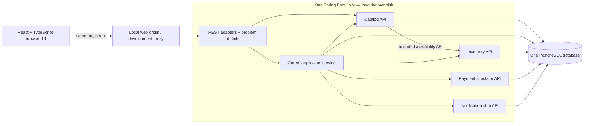
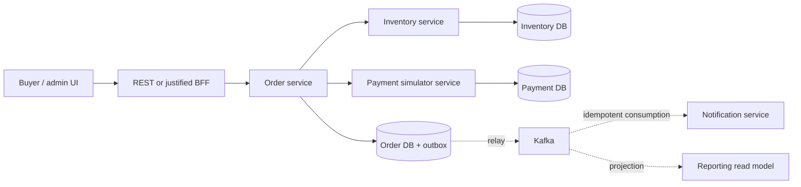
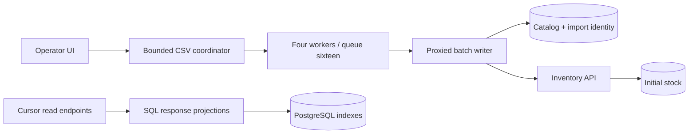

# HLD — the smallest useful commerce system

Status: this document describes the preserved Phase 0–2 monolith. The implemented distributed mode has its own [Phase 3 HLD](PHASE-03-HLD.md) and [LLD](PHASE-03-LLD.md). The diagrams below distinguish **current** components from **future learning options**. The uploaded blueprint supplies educational direction; its proposed commerce features and numerical targets are not verified bebo employer requirements or authorization to provision resources.

## Business boundary before deployment boundary

ECAL answers one narrow question: can a buyer see a product, submit a checkout once despite retries, and retrieve a durable, internally consistent outcome? Catalog owns what is sold; Inventory owns how many may be reserved; Orders owns the purchase lifecycle and immutable commercial snapshot; Payment owns a deterministic local authorization simulation; Notification owns a persisted simulation record. A bounded context need not be a network process.

## Current logical and deployment view

The browser never owns prices, inventory or payment truth. The Orders application service coordinates public module contracts in one **local** database transaction. PostgreSQL constraints and conditional updates enforce correctness across concurrent JVM threads and future duplicate application instances; JVM `synchronized` would not provide that guarantee.

Development uses a Vite proxy at port 5173 with a backend at 8090; the Compose path packages the application behind its local web origin. See the tested commands in the project README and Makefile rather than treating this diagram as an executable deployment specification. PostgreSQL's optional host-development binding is `127.0.0.1:5544`. Compose runs under an ECAL project identity so the existing Ark stack remains separate. No cloud resources are created.

## Why this shape, and why not the alternatives?

| Option | Fit now | What we pay / postpone |
|---|---|---|
| Modular monolith + one local transaction | Chosen: makes business invariants and failure atomicity visible with few moving pieces | One deployment and database failure domain; package boundaries need enforcement |
| Three microservices + separate databases | Valuable Phase 3 experiment for independent ownership and partial failures | Requires network contracts, reconciliation and cross-service workflow before the first learning outcome |
| Unpartitioned CRUD application | Fast to scaffold | Hides domain ownership and creates extraction friction; checkout invariants become accidental |
| One deployment with separate databases | Adds ownership friction without independent lifecycle value now | Cannot preserve the same ACID transaction; resembles distributed complexity without its deployment benefits |

The choice is reversible through module APIs, not through a promise that extraction will be effortless. A module's direct SQL stays in its own adapter; Orders coordinates interfaces, not another module's tables. The shared database does **not** establish an acceptable future service integration pattern.

## Data and consistency

Catalog prices and product names are copied into an order. Historical records must not change when the catalog changes. The unique `(buyer_id, idempotency_key)` pair represents one logical checkout for the server-selected demo buyer. A conditional stock decrement and a non-negative database check are separate defenses: the update resolves a race correctly; the constraint detects corruption or a bypassed path. Payment and notification records are database-only simulations in the same transaction. Catalog composition uses two bounded queries (a product page and availability for those product IDs), avoiding an N+1 inventory request for every listed product.

At READ COMMITTED, a conflicting unique-key insert waits for the other transaction's resolution. If the first transaction commits, the loser reads and compares that committed request. Identical input returns the original result; changed input receives a conflict. No separate request cache or Redis lock is needed. An insufficient-stock error rolls the transaction back, including its tentative key claim. The exact retry policy is specified in [LLD](LLD.md).

## Current failure boundary

- A process crash before commit leaves no completed purchase or simulated payment effect; PostgreSQL rolls back the open transaction.
- A response lost **after** commit creates client uncertainty. Replaying the same key/payload retrieves the result. A new key could create another order and is therefore unsafe recovery.
- A deterministic payment decline is a **business outcome**, not an exception that should erase evidence. The system releases stock and commits a cancelled order with a declined simulated payment.
- A database outage blocks checkout. The UI reports failure rather than optimistically claiming completion. The local stack has no HA guarantee.
- There is no remote payment request in this phase. Consequently, local rollback is valid here; it would not undo a real provider authorization. [ADR-014](../adr/ADR-014-reconciliation.md) describes the future change.

## Future reference only — not deployed

The dotted asynchronous path is Phase 4. Nothing in the current implementation claims outbox durability, Kafka delivery, Saga compensation across databases, distributed tracing, identity isolation or cloud recovery. The [roadmap](ROADMAP.md) gives entry/exit evidence for each change.

## Proof and review questions

Run the documented backend integration suite against real PostgreSQL, the frontend test suite and the browser journey. Verify concurrent same-key requests, competing stock reservations, declined-payment release and persisted status after a read. Architecture tests should fail if domain code imports Spring/JDBC or one module imports another's implementation.

Before scaling, ask: which requirement needs independent deployment; which invariant crosses the proposed boundary; how do we recover when only one side commits; what evidence justifies the added operating cost? These are stronger interview answers than listing infrastructure products.

## Phase 2 additions to the current deployment

The same JVM now serves cursor-paged catalog/history queries and a create-only CSV import. History is a synchronous read projection against the same database; no separate read service or asynchronous projection exists. The import coordinator admits one file per process, parses bounded input, schedules at most twenty batches on four workers, then returns all per-batch outcomes. Each worker transaction covers catalog product, inventory initialization through the Inventory API, and import fingerprint metadata. Reads and checkout continue on the shared twelve-connection pool. PostgreSQL remains the stock authority.

The batch transaction is the atomic boundary; the file is deliberately not atomic. Crash recovery is exact file replay, not an in-memory job ID. [ADR-015](../adr/ADR-015-keyset-read-model.md) and [ADR-016](../adr/ADR-016-bounded-import.md) document alternatives, tradeoffs and rollback. [Performance evidence](../../tests/performance/REPORT.md) justifies the selective index and continued absence of application caching. Security/service extraction/eventing/cloud components remain future phases.
