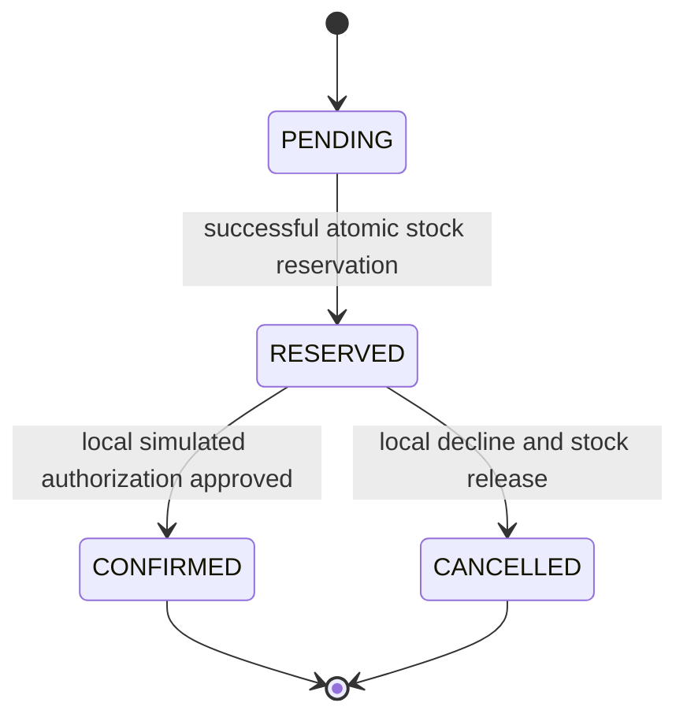
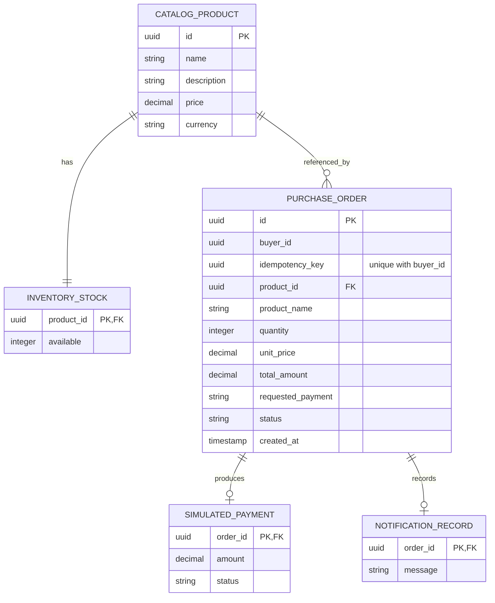

# LLD — checkout, concurrency and persistence

## Responsibility and dependency model

| Component | Responsibility | Deliberate limit |
|---|---|---|
| REST adapters | Parse UUIDs, validate request shape, call application API, map errors to problem details | No stock arithmetic, prices or transaction ownership in controllers |
| Catalog module API / SQL adapter | Return catalog views and authoritative price snapshots | Availability shown by a list is only a hint |
| Order domain aggregate | Admit legal lifecycle transitions; preserve money and commercial snapshots | No Spring, SQL, HTTP or remote calls |
| Checkout application service | Own the single transaction, idempotent request claim and synchronous workflow | Coordinates module APIs; not a future distributed transaction manager |
| Inventory module | Conditional decrement; release on deterministic decline | No read-then-write reservation |
| Payment simulator | Persist one approved/declined effect for an order | No card input, provider credentials, retries or real funds |
| Notification stub | Persist one simulated outcome notification | No email, Kafka producer or asynchronous delivery |
| Order persistence adapter | Claims keys, reads stored requests, persists and queries snapshots | No cross-module table updates |

Public contracts should carry meaningful Javadoc/TSDoc. Comments belong beside the unique-key race, conditional decrement and the “decline is not a rollback” choice. Ordinary accessors do not need line-by-line narration. See [Phase 1 walkthrough](../learning/PHASE-01.md) for the reasoning path.

## Request and transaction sequence

```mermaid
sequenceDiagram
  participant B as Browser
  participant H as REST adapter
  participant O as Checkout service
  participant DB as PostgreSQL transaction
  participant C as Catalog API
  participant I as Inventory API
  participant P as Local payment simulator
  participant N as Notification stub
  B->>H: POST /api/orders + Idempotency-Key
  H->>O: validated command
  O->>DB: BEGIN (READ COMMITTED)
  O->>DB: INSERT tentative order ON CONFLICT DO NOTHING
  alt committed key already exists
    O->>DB: read original requested product/quantity/outcome
    alt exact semantic payload matches
      DB-->>O: original persisted order
      O-->>B: 200 original result, no new effects
    else payload differs
      O-->>B: 409 idempotency conflict
    end
  else no committed key found
    O->>C: authoritative product / price snapshot
    O->>DB: INSERT tentative order ON CONFLICT DO NOTHING
    Note over O,DB: A lost insert race re-reads/compares the winning row
    O->>I: reserve(quantity)
    I->>DB: UPDATE ... SET available=available-quantity WHERE available>=quantity
    alt insufficient stock
      O->>DB: ROLLBACK tentative order and claim
      O-->>B: 409 stock conflict
    else stock reserved
      O->>O: PENDING → RESERVED
      O->>P: simulate APPROVE or DECLINE
      P->>DB: persist one local payment outcome
      alt APPROVE
        O->>O: RESERVED → CONFIRMED
      else DECLINE
        O->>I: release(quantity)
        O->>O: RESERVED → CANCELLED
      end
      O->>N: record simulated outcome notification
      N->>DB: persist one stub record
      O->>DB: persist final state; COMMIT
      O-->>B: 201 persisted final order
    end
  end
```

The first read is only an optimization: racing requests may both see no order. The conflict-safe insert is the actual claim. A lost insert race returns to the compare/replay path before any reservation. The catalog snapshot is resolved before insertion to satisfy the product foreign key. No intermediate order is advertised as committed progress.

## State invariants



A terminal state is immutable in this slice. Cancellation after confirmation, refunds, shipment and multi-line carts are not implicit extra transitions. Invalid transitions must fail in a pure domain test. Insufficient stock is a rejected command and rolls back its tentative order; it is not silently represented as a confirmed or cancelled purchase.

## Persistence model (logical names)



The physical schema uses `catalog_product`, `inventory_stock`, `purchase_order`, `simulated_payment` and `notification_record`. Use the migration as the physical schema authority. Money is a PostgreSQL fixed-scale numeric and Java `BigDecimal`; JSON represents it as a decimal string. Quantity is bounded to 1–10. Stock has a database non-negative check. A payment effect and notification stub are unique per order.

Terminal orders also require a non-null, status-compatible payment result. PostgreSQL `CHECK` accepts an unknown/NULL expression, so a condition comparing nullable `payment_status` to an enum is not enough: V3 explicitly adds the non-null terminal-state guard while preserving already-applied V1 migration history. The real PostgreSQL constraint test guards against direct SQL bypassing the domain.

The unique key is already scoped to `(buyer_id, idempotency_key)` even though the current buyer is fixed. Authenticated checkout must replace the demo identity with a trusted principal, review tenant isolation and define retention before Phase 5.

## Why conditional SQL wins the oversell race

Two requests may both observe stock `1` in the catalog. Each executes a conditional update for one unit. PostgreSQL locks the row while updating it and re-evaluates the predicate against the committed row after a competing updater completes. Exactly one update can affect that last unit. The loser observes an affected-row count of zero and receives a stock conflict. A `CHECK (available >= 0)` catches an incorrect writer; it does not replace handling the zero-row reservation outcome.

Optimistic version checking is a valid alternative when a richer aggregate is edited and retry semantics are explicit. `SELECT ... FOR UPDATE` is useful when several values must be examined together, but introduces lock acquisition/holding decisions. Neither a frontend stock check nor `synchronized` spans separate processes. See [ADR-009](../adr/ADR-009-concurrency.md).

## Idempotency race and rollback

The unique constraint is the concurrency arbiter, not a JVM map. `INSERT ... ON CONFLICT DO NOTHING` avoids a caught unique violation that can poison the current PostgreSQL transaction. At READ COMMITTED, a competing insert waits for commit/rollback; a subsequent statement can read the winning committed row. Store the requested simulator outcome as well as the product and quantity so changing `DECLINE` to `APPROVE` with the same key is a conflicting replay.

If the winner rolls back, another request may claim the key and execute normally. Requests rejected for validation, unknown product or insufficient stock do not acquire a durable completed result. This is a consciously narrower policy than caching every rejected response. Price is excluded from the client command; retries of a committed order return its original snapshot even if the current catalog price changes.

The browser retains the key **and exact submitted payload** after an uncertain request. It must not let a user change quantity and reuse the uncertain key. Reloading a client without a retained key is not a promise of cross-session recovery; retrieve persisted history before inventing another purchase. Session storage preserves the frozen command/key across reloads within the same tab session; it is not a cross-device recovery ledger.

## Error and thread behavior

Each HTTP request uses a normal servlet thread and a pooled JDBC connection while the transaction is active. Concurrency tests use separate threads/connections, not sequential calls labelled “concurrent.” Checkout uses no application worker or Kafka consumer; Phase 2 import has a separate bounded worker path. A deterministic payment decline follows a normal business branch and commits its cancelled record; infrastructure errors escape the transaction and roll everything back.

Validation is 400, missing product/order is 404, stock/key conflicts are 409, storage failure is 503, and unexpected failure is a controlled 500. Unsupported resources/methods/media types retain their framework 404/405/415 client status through the generic `ErrorResponse` branch instead of being misreported as an internal outage. The REST boundary emits RFC 9457 problem details with a stable `code`, not SQL text or stack traces. Unexpected failure must never be converted into “payment definitely failed”; the client keeps an uncertain request retryable. Checkout explicitly requests READ COMMITTED with a ten-second transaction timeout; the connection pool has a five-second connection-acquisition timeout. These are finite local work limits, not a measured p95 target. Configure and test lock/statement policies before accepting slow external dependencies. The current simulator makes no remote call, so there is no invented provider timeout policy.

## Verification inventory

1. Pure domain tests: valid and illegal transitions, exact money behavior.
2. Real PostgreSQL integration: persisted approval, decline/release, same-key replay, mismatched replay, concurrency on one stock row, same-key races and rollback after failure.
3. HTTP tests: required UUID header, malformed input, problem detail shape, decimal-string contract, read-after-write and preserved 404/405/415 statuses. `OpenApiContractTest` additionally checks schema field sets against the actual HTTP records and validates the decimal regex; this is structural drift detection, not a complete OpenAPI response validator.
4. Architecture tests: framework-free domain and no implementation-package imports across modules.
5. UI tests: loading/error state, uncertain request retains the same command/key, persisted status and accessible controls.
6. Browser E2E: open catalog, submit a simulated order, reload/read its stored status.

Test existence and observed execution are separate facts; the root validation report records actual runs. No coverage percentage, throughput or p95 result is implied here.

## Phase 2 read and import boundaries

`PageCursor` encodes version/scope plus the last sort tuple. It bounds encoded input and rejects mismatched filter scopes, invalid UUID/time values and trailing data. Limit is 1–50. `OrderHistoryQuery` has fixed parameterized SQL shapes for ALL versus a selected status; optional tuple comparison continues the page. It projects response columns without domain restoration. Catalog executes one bounded product query and one bulk availability query; empty catalog needs only the first. Integration instrumentation at JDBC prepareStatement proves constant read counts.

`CatalogImportService` parses the full bounded file before submitting work. Commons CSV handles real quoting/newlines; duplicate headers/IDs, malformed UTF-8 and inconsistent columns reject before writes. `ImportBatchWriter.write` is a different, non-final Spring bean with REQUIRES_NEW, READ_COMMITTED, timeout ten seconds. Each batch sorts product UUIDs before writes, uses INSERT ON CONFLICT DO NOTHING, initializes stock only on a new product, and persists a canonical original-payload SHA-256 fingerprint in V5. Existing identical imports skip; conflicts and business validation throw across the proxy, rolling back the complete batch. The coordinator catches the failure only after the transactional proxy has completed rollback.

Four worker threads plus a sixteen-element queue bound submitted batches; the max file contains twenty batches. One process-local semaphore admits a file. There is no transaction on the coordinating HTTP thread and no transaction shared across workers. Responses preserve input batch order even if workers finish out of order. The browser presents failedBatches on HTTP 200 as partial completion and instructs corrected replay. Unknown outcomes retain the original file as retry identity. No successful-batch compensation, durable job status, update/replenishment operation or cluster-wide admission is implied.

V4 adds the selective covering order index and catalog tuple index; V5 stores import identities. Both are additive Flyway migrations. The [Phase 2 guide](../learning/PHASE-02.md) covers JPA alternatives, N+1, isolation, failure cases and interview exercises; [OpenAPI](../../contracts/openapi/commerce.yaml) defines page and multipart/result contracts.

Infrastructure exceptions can occur around commit, so such batches report `UNKNOWN`, not a promise of rollback. `failedBatches` counts both ROLLED_BACK and UNKNOWN; created/skipped counts include only acknowledged committed batches. Replay the same file to resolve uncertainty. A unit test injects a connection-loss exception to guard this distinction.

## Separate Phase 3 implementation

This file describes the runnable monolith. [Phase 3 LLD](PHASE-03-LLD.md) documents its separate service code, owned schemas, versioned contracts, durable states, token-fenced recovery and migration semantics. Do not apply the monolith's global rollback claim to the distributed mode.
