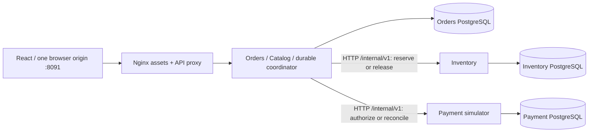

# Phase 3 HLD — three owners, independent commits

Status: implemented learning slice. The [Phase 2 monolith](HLD.md) remains a runnable comparison, not an architecture we silently rewrote. The uploaded blueprint is reference material, not an employer requirement or permission to deploy paid infrastructure.

## Scope and ownership

| Deployment | Owns | May call | Must not do |
|---|---|---|---|
| Orders | Catalog price/name data, order snapshots, workflow progress/leases, local simulated notification records | Inventory and Payment versioned HTTP APIs | Read their databases or claim an HTTP call participates in its SQL transaction |
| Inventory | Available stock and immutable order-keyed reservation decisions/tombstones | Its PostgreSQL database | Read Orders tables, authorize payment, or expire an uncertain reservation automatically |
| Payment simulator | One immutable amount/currency/requested outcome/result per order ID | Its PostgreSQL database | Move real money, overwrite a previous identity, or treat a caller timeout as reversal |
| Nginx + React | Same-origin assets/API routing and one browser journey | Orders public API | Own stock/payment truth or coordinate database commits |

Catalog and notification recording remain collocated with Orders; collocation does not make every bounded context its own service. The next extraction must have its own reason. `service-support` contains HTTP problems, context propagation and paging utilities, not domain records/repositories. Independent wire DTOs and OpenAPI describe integration. ArchUnit prevents importing another service's implementation.

Three separate PostgreSQL instances/volumes/credentials run in the Phase 3 Compose project; none publishes a host port in full Docker mode. The monolith remains at loopback 8090, distributed mode at loopback 8091, Ark at its existing separate origin. This is not a public deployment, authentication boundary or multi-AZ design. The integration suite uses three credential-isolated logical databases on one disposable PostgreSQL process to reduce test resource usage; it does not claim physical failure isolation at that test tier.

## Why synchronous orchestration first?

We are isolating the consequences of service extraction before adding messaging. Orders durably records intent, calls one owner at a time, and records acknowledgements in short local transactions. The workflow already has Saga-like semantics: a decline requires compensating stock release, which can itself fail. We call that out rather than implying that a monolith's ACID transaction survived extraction. Phase 4 adds an outbox/relay and event-driven execution, deduplication and background recovery; those are not delivered here.

A request returning 503 may leave a committed reservation or payment. The UI retains the exact key/payload, displays an intermediate history state without inventing a decline, and resumes by replaying POST. There is no automatic background completion while the caller is absent. GET is read-only. The same order ID is the downstream operation identity, so replay can discover a prior effect without creating another one.

## Consistency and latency

Only one owner's transaction is atomic. Terminal CONFIRMED means an authorization acknowledgement was validated; CANCELLED means a decline plus acknowledged release. Until then, state can be PENDING, RESERVED, PAYMENT_UNKNOWN or RELEASE_PENDING. Unknown authorization holds stock; automatically releasing it could allow another buyer to consume stock for an already authorized order. Rejected stock attempts remain durably REJECTED in this mode, unlike the monolith's rolled-back claim.

Network calls add latency and availability dependencies. Defaults: 500-ms connect, 2000-ms request timeout per internal call; no application-level immediate retry loop; redirects disabled. JDBC writes use short five-second transactions; connection acquisition is bounded. A 30-second per-order lease reduces competing coordinators without holding a database connection during HTTP. Expiration permits overlap, so correctness also requires downstream immutable identities and token-fenced state writes. A lease is not a distributed exactly-once guarantee.

Catalog reads compose one local product query with one bounded remote stock request; an unavailable stock owner causes 503 instead of fabricated zero availability. Phase 2's measured covering-index gains cannot be carried across this new network architecture as a performance claim. Phase 3 uses narrower order-history indexes while the workflow writes several states; a mixed read/write benchmark is a future measurement, not an assumed optimization.

## Observability and operations

Each HTTP attempt has a validated/generated X-Correlation-ID and W3C trace ID. Child hops keep trace ID and sampling flags while generating a new span ID. Structured logs carry correlationId/traceId; coordinator logs identify the stable order ID across retries. A failed checkout exposes a support reference in the UI. This is context propagation and log correlation, not exported OpenTelemetry spans, service maps or an observability SLA.

Node health checks cover its database, not every downstream dependency. Orders can remain healthy and persist a recoverable intent while Payment is unavailable. Compose startup waits for dependencies initially; runtime failure still needs the workflow policy. No circuit breaker, service discovery platform, Kubernetes, cloud resource or cache was added merely to fill the diagram.

[LLD](PHASE-03-LLD.md), [ADRs](../DECISION_LOG.md), [migration runbook](../runbooks/PHASE-03-MIGRATION.md), [learning guide](../learning/PHASE-03.md) and [observed validation](../../VALIDATION.md) provide implementation paths and evidence.
