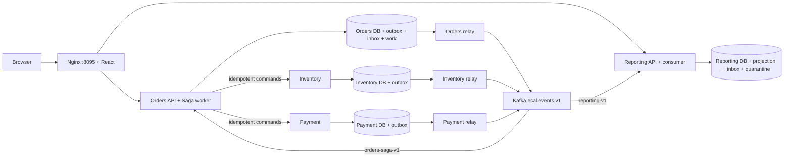

# Phase 4 — durable event delivery and autonomous execution

Status: runnable educational slice. Phase 3 remains the synchronous comparison; its default configuration does not enable Kafka or the additional migrations. This implementation follows the Phase 4 reference goals while making one deliberate boundary choice: Kafka activates durable Saga work and transports facts; Inventory and Payment commands remain bounded, idempotent HTTP. This is an orchestrated hybrid, not a fully choreographed checkout.

## Ownership and guarantees

There are four database owners with distinct credentials and no cross-database application reads. Each operational owner emits facts in its local business transaction using PostgreSQL triggers. Orders commits `PENDING` and `OrderCreated` before returning **202 Accepted**, with a `Location` header. It does not promise stock or payment success. An existing terminal operation returns 200, including `REJECTED`; the status is authoritative. Product and idempotency validation still precede acceptance.

An outbox relay publishes with the order UUID as partition key and waits for Kafka acknowledgement before marking the row published. A process failure between those two writes causes duplicate delivery. There is no atomic Kafka/PostgreSQL commit and no end-to-end exactly-once claim. Inbox insertion and each consumer's durable effect commit together; Kafka acknowledgement follows that commit. Duplicate event IDs with the same fingerprint are harmless; identity reuse with changed content is quarantined.

The Orders consumer inserts a durable `saga_work` row when `OrderCreated` arrives. It acknowledges Kafka after committing the work, rather than keeping a partition blocked during a downstream outage. A worker resumes the existing fenced coordinator. The original order ID keys Inventory and Payment effects. Payment uncertainty keeps stock reserved; a recorded decline releases stock before cancellation. A crash after any remote commit is recovered by an idempotent command against the same owner ledger. Background retry times survive process restarts. Unknown outcomes are never converted into declines by timers.

Reporting consumes full snapshots of the reportable Orders state into its own database. These snapshots contain all projection fields; they are not backups of the entire Orders aggregate or an event-sourcing implementation. It applies only a higher **Orders** aggregate version. Inventory and Payment versions belong to their own source and cannot be compared to Orders versions. A newer full snapshot can skip an older one; this would not be safe for an incremental balance adjustment. The report includes last projection time, observed time, quarantine count and an eventual-consistency notice. An idle timestamp does not prove a broker outage; use actual consumer-group lag in the runbook.

## Deployment and limits

`compose.phase4.yaml` creates an isolated project with four PostgreSQL instances, four JVM services, Kafka and Nginx. Only `127.0.0.1:8095` is published. The optional `compose.phase4.compact.yaml` reduces this to seven containers by hosting four distinct databases on one PostgreSQL process. A bootstrap-only admin creates four ordinary application roles and revokes public database connection privileges; runtime applications receive only their own credential. This retains logical ownership while sharing a physical failure domain. Compact mode has its own data volume and requires Compose 2.24.4+; the cloud runtime validation uses this topology to fit its disk budget. Existing Phase 2/3 volumes are never mounted. Kafka 3.9.1 is a single persistent KRaft broker, using 1 MiB development segments and seven-day retention. Spring Boot 4.1.1 manages Spring Kafka 4.1.1 and Kafka client 4.2.1; the real-broker integration tests exercise this combination. Single-broker acknowledgement is not replicated durability. This local lab has neither authentication nor broker TLS/ACLs; public deployment belongs to later work.

One relay serializes each owner's stream through a transaction-scoped advisory lock and publishes one row per tick (default 100 ms). This bounds complexity and throughput to approximately ten events/second/owner before broker latency. A relay holds its own local transaction during a bounded send; the business coordinator still holds no JDBC transaction across HTTP. This tradeoff preserves source ordering across relay replicas. A production design needs measured batching, sharding, retention, alerts and load tests before scaling.

Published outboxes, inboxes and quarantine records are retained in this slice. Broker retention is finite; the database records are a recovery resource, not a tested disaster-recovery product. No automatic purge, replay UI, schema registry, multi-broker failover, export of OpenTelemetry spans, real payment gateway or cloud deployment is claimed. Notification remains the existing transactionally written simulation in Orders.

See [LLD](PHASE-04-LLD.md), [learning and operations guide](../learning/PHASE-04.md), and [ADR 021](../adr/ADR-021-event-driven-execution.md).
