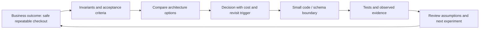

# Phase 0 — turn an interview syllabus into a defensible system

## Objective and competency

A Staff Engineer can explain a correct component. A Solution Architect must also establish **which business outcome matters, which constraints are real, which alternatives were rejected, and how confidence will be earned**. This phase establishes that chain without building the whole proposed end-state.

The direct user request is the scope authority: a runnable Phase 0/first-small-Phase-1 application with HLD, LLD, decisions, comments and tests. The uploaded master prompt and blueprint are reference material. Their hypothetical commerce domain, future phases, target numbers and example cloud choices are learning proposals, not confirmed employer/customer requirements or separate deployment authorization.

## Read in this order

1. [Product and requirements](../requirements/PRODUCT_AND_REQUIREMENTS.md): vision, personas, assumptions, BR/FR and acceptance examples.
2. [Quality scenarios](../requirements/QUALITY_SCENARIOS.md): correctness obligations versus unmeasured performance/availability/recovery targets.
3. [Threats and risks](../requirements/THREATS_AND_RISKS.md): local exposure, replay, data ownership and future trust boundaries.
4. [HLD](../architecture/HLD.md): current deployment/domain boundaries and alternatives.
5. [LLD](../architecture/LLD.md): lifecycle, SQL concurrency, request/transaction sequence and persistence.
6. [Decision log](../DECISION_LOG.md), [traceability](../TRACEABILITY_MATRIX.md), [roadmap](../architecture/ROADMAP.md).

The documents are a **reviewable working baseline**. No stakeholder review, production-readiness certification, cloud deployment or benchmark result is implied.

## The reasoning chain



**What:** a deliberately small commerce learning system. **Why:** it makes concurrency and retries observable through one coherent journey. **Why not a broad scaffold:** empty service directories cannot demonstrate that an invariant holds. **Trade-off:** the first phase leaves many realistic commerce features unfinished. **Failure behavior:** documented assumptions can be wrong; the design must be revised transparently rather than turning a learning default into an unexamined production requirement. **Proof:** a learner can trace each current requirement to code and a test, while identifying future guarantees that do not yet exist.

## HLD versus LLD, using this repository

The HLD answers “what are the responsibilities, deployment boundaries, data ownership and failure domains?” It does not need every method. The LLD answers “which class calls which interface, where is the transaction, what SQL resolves the race, what can commit, and what does a retry mean?” A sequence diagram without a marked commit boundary is insufficient for this checkout.

The current HLD's one JVM/one PostgreSQL database enables a local ACID transaction. The five feature modules do not constitute five microservices. The future Kafka diagram is explicitly labelled future. That distinction is an interview signal: implementation claims should follow evidence, not vocabulary.

## Candidate architectures and reversal cost

- **Modular monolith:** lowest operational burden for this scope, clear local atomicity, shared release/failure domain. Chosen in [ADR-001](../adr/ADR-001-modular-monolith.md).
- **Microservices:** useful for independent ownership/deployment, but create partial-success problems. Defer until contracts and invariants are understood.
- **Single database:** clear transactional proof now; requires ownership migration later. A shared database is not free future independence.
- **Database per service:** prevents hidden cross-table coupling after extraction, but demands business recovery across local transactions. Deferred in [ADR-008](../adr/ADR-008-database-ownership.md).

The reversal plan is not “just extract packages.” It requires contract versioning, data migration, transaction redesign, observed recovery behavior and rollback ownership. The roadmap makes this work visible.

## Local reproduction and inspection

From `ecal/`:

```sh
make up       # build/start the isolated local stack
make verify   # backend unit + real-PostgreSQL integration, frontend tests/build
make e2e      # browser journey against the running application
```

For host development use `make dev-db`, `make dev-backend` and `make dev-frontend` in the documented terminals. See the project README for prerequisites, exact addresses and evidence from this environment. `make verify` needs Docker for Testcontainers; a skipped database test is not proof of SQL correctness.

Inspect these actual files rather than memorising a generic diagram:

- `backend/modular-monolith/src/main/java/com/ecal/order/application/CheckoutService.java`: transaction owner and demo identity limitation.
- `.../order/domain/Order.java`: business lifecycle independent of Spring.
- `.../inventory/internal/JdbcInventory.java`: database-atomic reservation.
- `.../order/internal/JdbcOrderStore.java`: unique request claim and historical snapshot.
- `contracts/openapi/commerce.yaml`: HTTP semantics and replay contract.

## Failure questions before technology choices

1. If two buyers see one unit, which authority decides who gets it? PostgreSQL, at conditional mutation time; the catalog response is only a hint.
2. If the response disappears, what does the user know? The result is unknown, not definitely declined; replay the same logical request.
3. If the payment provider is outside the database, can rollback undo its authorization? No. That future boundary needs reconciliation, not optimistic narration.
4. If the database volume is lost, has an RPO/RTO target been met? No recovery target is achieved until backup/restore is executed and measured.
5. If someone binds this demo publicly, is a fixed buyer secure? No. Loopback-only exposure and synthetic data are current restrictions; identity/object authorization are prerequisites for wider use.

## Interview checkpoint — short model answers

**How do you choose a microservice boundary?** Start with business ownership/invariants and team/deployment needs, then identify where a local transaction becomes a cross-service workflow. A table is not automatically a service.

**What makes an NFR useful?** A stimulus, environment, response and measure. “Fast” is not testable; a stated p95 target with a workload is a hypothesis until a reproducible benchmark records the result and hardware context.

**Why write an ADR rather than a long design document only?** An ADR preserves a decision's context, options, consequences, validation and revisit trigger. It helps a future engineer understand why a once-reasonable choice changed.

**What is the biggest risk in this slice?** Mistaking a truthful local transaction demonstration for a production multi-user commerce platform. The explicit exclusions and threat model prevent that claim.

**How would you present this to a customer in two minutes?** Lead with safe checkout and repeatability, show the smallest current system, explain the prevented failures, state operational limits, and name the next experiment with its acceptance evidence.

## Exercises

- Draw the current HLD from memory without including Kafka. Then add Kafka and mark every new failure boundary.
- Change assumption A-02 to a multi-item cart. Identify lock ordering, partial allocation, contract, test and rollback changes before editing code.
- Pick an illustrative NFR and write a benchmark protocol: hardware, dataset, concurrency, warm-up, sample count and reported percentiles. Do not supply invented results.
- Challenge the fixed demo identity: list the changes required before accepting real buyer data. Trace them to the Phase 5 gate.

## Exit and next step

Phase 0's deliverable is a coherent, runnable and reviewable foundation—not proof that all stakeholders agreed. Continue with [Phase 1](PHASE-01.md), where the claims become executable invariants. Capture actual command outcomes in the validation report; keep proposed and observed outcomes separate.
