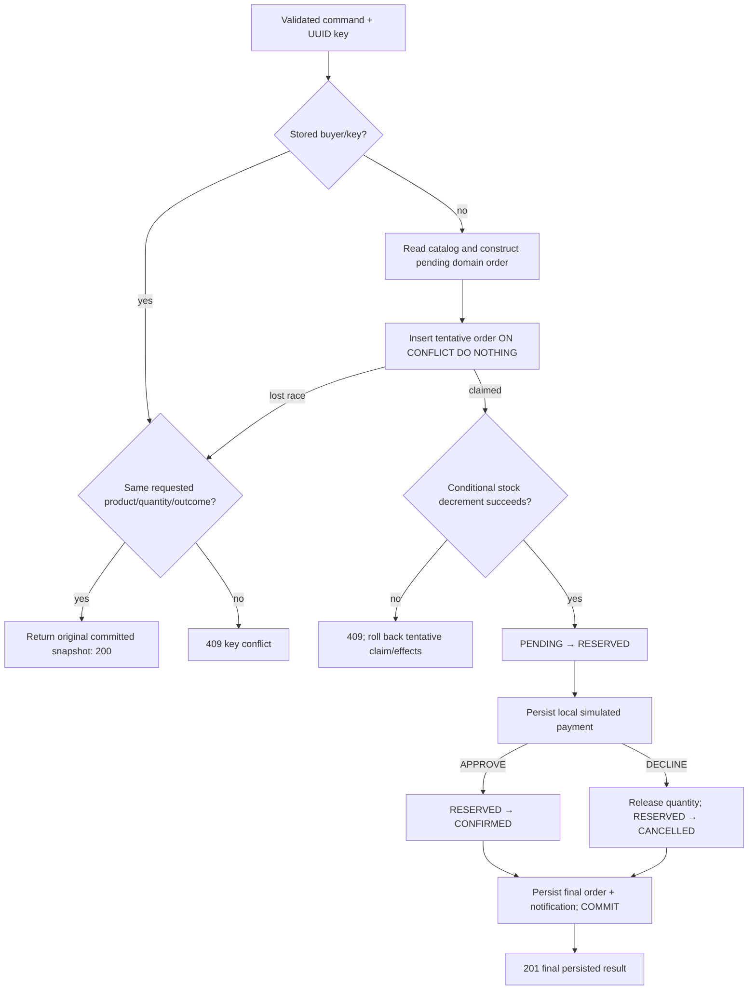

# Phase 1 — one purchase, one local transaction, provable invariants

## Scope and learning goal

The buyer browses seeded products, chooses one product and quantity 1–10, selects a visibly simulated APPROVE/DECLINE result, submits checkout and views the persisted order. A fixed server-selected demo buyer keeps identity out of the command without pretending to implement authentication. No real funds, email, event broker or cloud resource is involved.

The architectural skill is explaining **why** each responsibility and transaction belongs where it does, then showing a test that could falsify the claimed guarantee. Framework annotations are mechanisms, not the guarantee by themselves.

## Source walk: request to durable result

Read the following files under `backend/modular-monolith/src/main/java/com/ecal/` in order.

| File / contract | What happens | Why / trade-off / proof |
|---|---|---|
| `order/web/OrderController.java` | Validates a UUID header/body, calls checkout, returns 201 for new processing or 200 for replay with a Location header | HTTP syntax stays at the adapter; tests must check status, body and safe problem details |
| `order/application/CheckoutService.java` | Owns `@Transactional(timeout=10, isolation=READ_COMMITTED)`, selects demo buyer, reads replay first and coordinates module APIs | One local boundary makes failure atomicity understandable; no remote side effect may be inserted casually |
| `order/internal/JdbcOrderStore.java` | Reads by buyer/key, inserts a tentative order with conflict-safe claim, saves final snapshots | A DB uniqueness invariant spans threads/JVMs; `ON CONFLICT` avoids continuing after an aborted uniqueness exception |
| `catalog/api/Catalog.java`, `catalog/internal/JdbcCatalog.java` | Returns authoritative product/price views | A browser cannot choose the charged amount; price/name snapshots keep historical orders stable |
| `order/domain/Order.java` | Calculates exact totals and permits only valid state changes | Pure domain tests run without Spring/DB; domain code does not know HTTP or JDBC |
| `inventory/api/Inventory.java`, `inventory/internal/JdbcInventory.java` | Atomically reserves or releases stock through affected-row conditional SQL | Prevents oversell at the authority; integration tests must use real PostgreSQL contention |
| `payment/api/Payments.java`, `payment/internal/LocalPaymentSimulator.java` | Persists one local AUTHORIZED/DECLINED effect | Determinism makes failures reproducible; this does not model a real provider's unknown outcome |
| `notification/api/Notifications.java`, `notification/internal/RecordingNotifications.java` | Persists a simulated notification record inside the transaction | No external delivery gap exists yet; an external notifier will require the outbox decision |
| `shared/ApiErrors.java` | Maps validation/business/storage failures to problem details | Stable machine codes support recovery; SQL and stack traces do not become response details |

Mutating module adapters require an existing transaction through Spring `MANDATORY` propagation. This is a deliberate tripwire: a future controller must not reserve stock outside the checkout transaction merely because the SQL statement itself is atomic. Spring proxy interception matters; direct self-invocation is not a new transactional boundary.

## The flow you should explain on a whiteboard



`CheckoutService.checkout` is the transaction boundary. The initial by-key lookup is a fast path, not the concurrency control: two threads may both see no row. The unique constraint and insert claim decide the race. A new catalog lookup occurs only after that initial replay check, so a committed replay does not need to recompute its historical price. Creation times are truncated to microseconds before the initial response because PostgreSQL timestamps persist microsecond precision; otherwise first response and replay could differ by nanoseconds even when they refer to the same order.

The database claim contains the catalog snapshot before stock is reserved. Other transactions cannot read that uncommitted PENDING record as a successful outcome. The domain's RESERVED transition occurs in memory; the adapter persists the final state before commit. The simulator and notification adapters share the same connection-bound transaction, so a late notification failure rolls back earlier stock/payment changes too.

## Non-obvious logic, line by line in reasoning terms

1. **Validate before doing work.** A malformed command is not a business order. The service also guards its public application contract so a non-HTTP caller cannot bypass quantity constraints.
2. **Look up `(buyer_id, idempotency_key)`.** Identity is server-selected in this lab. The schema already scopes the key to buyer; future authenticated identity must preserve that scope.
3. **Compare semantic inputs.** Product, quantity and requested simulator outcome all matter. A repeated key is not permission to mutate the original request.
4. **Read the server catalog and create a snapshot.** Never trust a client-submitted total. `BigDecimal` and fixed-scale SQL avoid floating-point money artifacts.
5. **Claim with `ON CONFLICT DO NOTHING`.** PostgreSQL waits on a conflicting uncommitted unique index entry. At READ COMMITTED, the next query sees a committed winner. Do not catch a uniqueness error and continue in a PostgreSQL transaction that has already been aborted.
6. **Check the affected row count from reservation.** `UPDATE ... WHERE available >= quantity` is the decision, not a prior stock read. A zero-row update becomes an insufficient-stock conflict.
7. **Treat decline as an ordinary outcome.** Release stock and commit CANCELLED/DECLINED for auditability and stable replay. Throwing an exception for decline would erase that evidence.
8. **Commit all local effects together.** An injected late failure should leave no committed order, payment, notification or stock decrement. The test must inspect every affected table, not only the API response.
9. **Return a stored/snapshot result.** A 201 can still be lost on the network. Replaying the same key/payload is how the client resolves that ambiguity.

The ten-second transaction timeout is a conservative local upper bound, **not a measured latency SLO or a payment-provider timeout**. It limits abandoned database work; the PostgreSQL lock/statement settings and request errors also matter. Add no slow external call inside this transaction without revisiting its lock duration and rollback semantics.

## Frontend reasoning

Read `frontend/src/api.ts` for typed HTTP contracts and `frontend/src/App.tsx` for the local state transitions. Read their tests alongside the code.

- Component state covers product selection, quantity, fake outcome, loading/error and saved history. No current cross-route server cache justifies Redux.
- A submitted command is separate from editable form state. On transport/server uncertainty, keep its exact payload/key and provide a retry; do not silently create a new logical purchase.
- Refresh catalog/history after an acknowledged outcome. Display server prices/status; do not generate fictitious success or counters locally.
- Text rendering, labelled controls and error/loading states are part of the API integration contract, not a finishing theme.
- The app explicitly states that payments and identity are simulated/local. A convincing UI must not imply actual commerce security.

## How to reproduce the important failures

From `ecal/`, use the project README's pinned prerequisites and `make up` or the host-development targets. Then run:

```sh
make verify
make e2e
```

The backend test classes are `OrderTest`, `ArchitectureTest` and `CheckoutIntegrationTestIT`; the integration suite is run by Maven Failsafe during **verify**, not by assuming `mvn test` includes it. Testcontainers requires Docker and must fail visibly if its real database is unavailable. Frontend tests run with Vitest/RTL; E2E uses Playwright against the running app.

| Experiment | Mechanism | Expected invariant / boundary |
|---|---|---|
| Approve and read back | Normal UI/HTTP journey | CONFIRMED/AUTHORIZED stored with server-calculated decimal total |
| Decline and replay | Select DECLINE, replay same key | CANCELLED/DECLINED persists; stock restored; one local payment and notification |
| Last unit contested | Coordinated parallel requests/connections | One successful reservation, no negative stock or partial losing effects |
| Identical-key race | Concurrent same-key commands | One purchase and payment effect; both callers resolve the same result |
| Changed payload | Replay key with changed quantity/outcome | 409; original order unchanged |
| Late local failure | Integration failure injection after earlier writes | Entire local transaction rolls back, including claim and stock |
| Lost response | Frontend mock/network failure after submission | Same frozen command/key remains retryable; no unsupported claim of failure |
| Database unavailable | Stop only the disposable ECAL DB, retry/read and restart | Safe storage failure, no fabricated confirmation; same-key recovery after service returns |

Do not run destructive resets against the Ark database or a shared database. Use the isolated ECAL Compose project and disposable integration containers. A Testcontainers race test proves the exercised schedule and database invariant; it is not a throughput benchmark or a proof of cloud HA.

## Interview checkpoint — five defensible answers

**Why not use `synchronized` to prevent overselling?** It serializes only one JVM. A database-conditional mutation protects the authoritative row across connections and processes. The non-negative constraint is a second defense.

**Does `@Transactional` make payment safe?** Only because this simulator's effect is another row in the same database. A real provider cannot be rolled back by Spring; unknown outcomes need stable attempt IDs and reconciliation.

**What does idempotent mean here?** For one buyer/key and the same requested semantic payload, replay returns the original committed result without another stock/payment effect. Conflicting input is rejected. Invalid/stock-rejected attempts are rolled back rather than durably cached outcomes.

**Why choose JDBC over JPA?** This slice teaches affected-row reservation and conflict-safe insertion explicitly. JPA is a valid alternative for richer aggregate mapping; it still needs correct concurrency policy and real database tests.

**Where are CQRS and Saga?** They are future decisions, not labels attached to a local service and a GET endpoint. The current application uses one source of truth and one local transaction; extraction/events introduce the conditions that make those patterns useful.

## Hands-on exercises

1. Temporarily change reservation to a read-then-write algorithm in a disposable branch. Make the concurrency test fail; explain the schedule before fixing it.
2. Remove a payment/notification write from the transaction. Design a late-failure test that exposes the inconsistency rather than merely testing a method was called.
3. Change a catalog price after a successful purchase and replay its original command. Explain why the persisted total must remain unchanged.
4. Propose a multi-line cart. Define sorted lock acquisition, all-or-nothing allocation and retry behavior before adding another loop.
5. Draw a real-provider success-then-timeout. Mark exactly where the current rollback reasoning stops applying and write the next ADR/test scenario.

## What comes next

Preserve this runnable baseline. Finish any uncovered Phase 1 edge case before measuring a concrete Phase 2 data path. Introduce cache, messaging, identity and independent deployment only with a requirement and a proof plan. The [decision log](../DECISION_LOG.md) and [roadmap](../architecture/ROADMAP.md) identify those revisit triggers.
