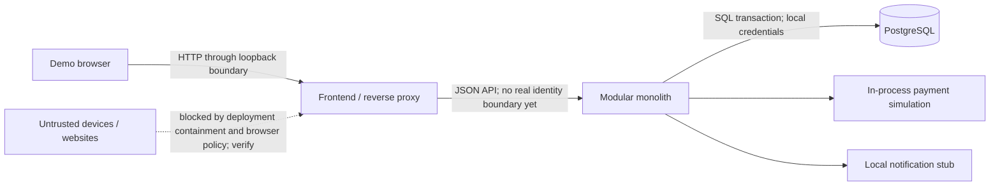

# Threat model and risk register

Status: initial Phase 0 model for a **loopback-only learning lab**. This is not a penetration-test result, production security review or approval to expose the application publicly.

## Assets, actors and trust boundaries

Assets are catalog/price integrity, stock counts, persisted orders, simulated payment/notification records, idempotency-key associations, source/configuration and the local database volume. Data is synthetic; the first slice must not collect real buyer identities, card data or live provider credentials.

The legitimate actor is a learner using a trusted workstation/browser. Potential attackers include another process on that workstation, a malicious website the learner visits, an accidental public port exposure, malformed clients and compromised dependencies. “Only local” reduces network reachability; it does not turn the workstation or browser into a trusted identity provider.

The database connection is a separate technical boundary but not a separate distributed business transaction. Payment simulation and notification stub have no outbound provider connection. An API buyer ID is selected by the server for this demo; order IDs and idempotency keys are identifiers, not authentication secrets.

## Threat scenarios and required handling

| ID | Threat / failure mode | Current-slice handling or constraint | Proof and residual risk |
| --- | --- | --- | --- |
| T-01 | Caller changes price/total in a browser request | Server resolves product price and records an immutable order snapshot; decimal arithmetic prevents binary floating-point surprises | API/transaction tests; future promotions/taxes need explicit contracts |
| T-02 | Parallel requests oversell stock | Conditional stock update and non-negative database invariant; do not use naïve read-then-write | Real PostgreSQL contention test; all future stock mutation paths must preserve the invariant |
| T-03 | Duplicate/replayed checkout multiplies effects | Unique idempotency key, command equivalence check and atomic local effects | Sequential/concurrent replay and conflicting-payload tests; keys are not a substitute for a future buyer-scoped authorization model |
| T-04 | Caller reads other people's orders or changes simulator behavior | There are no real people/accounts yet; all data belongs to a fixed demo buyer and the app stays on loopback | Explicit limitation. Synthetic payment outcome is intentionally client-selectable only for this lab. Authentication/RBAC and object-level tests are mandatory before external access |
| T-05 | SQL injection or malformed input | Parameterised persistence operations, typed UUIDs/enums/quantity bounds, validated request DTOs | Negative HTTP tests and code review; validate new query/filter paths as they are added |
| T-06 | Catalog/error text executes script in the browser | Render data as React text and avoid raw HTML injection; avoid broad CORS permission | Frontend unsafe-text/error tests and config review; CSP and identity/session design must be revisited for a deployment |
| T-07 | Cross-origin website drives local state changes | Use JSON API contracts and same-origin/proxied frontend; do not add wildcard credentialed CORS. Loopback is containment, not complete CSRF protection | Verify actual Content-Type/CORS behavior; do not claim a production session/CSRF design exists before authentication is introduced |
| T-08 | Error body leaks SQL, stack traces or credentials | Stable problem details with controlled messages; configuration must not commit real secrets | Negative integration tests and repository review; developer logs may still be sensitive in a future real-data deployment |
| T-09 | Resource exhaustion through huge quantities/history requests | Bound quantity 1–10 and latest-order response to 50; keep demo access local | Validation/bound tests; no production rate limiting, admission control or load-shedding claim |
| T-10 | Supply-chain compromise | Pin dependency versions, preserve lockfiles and use trusted registries/TLS; automated tests establish behavior, not absence of malicious dependencies | Dependency review and future security/license scans; no claim of a vulnerability-free build |
| T-11 | Local volume is deleted or laptop/cloud host is lost | Persistence survives app restart only while the database volume survives | Document destructive reset explicitly; no automatic off-machine backups exist yet |
| T-12 | Real payment integration is added using current assumptions | Simulator has no irreversible external effect; one local transaction cannot roll back a real charge | Treat provider integration as an architecture change requiring idempotency, unknown-outcome reconciliation, audit and failure tests before use |

## Risk register

| ID | Risk | Likelihood / impact for this learning slice | Mitigation / owner | Revisit trigger |
| --- | --- | --- | --- | --- |
| RISK-01 | Local demo accidentally exposed publicly | Medium / High | Developer: bind host ports to loopback; no real data or provider credentials; state the identity gap prominently | Any hosting, tunnel, shared machine or external user request |
| RISK-02 | Test doubles hide PostgreSQL concurrency semantics | Medium / High | Backend engineer: test overselling/idempotency against real PostgreSQL, not only an in-memory substitute | Changes to locking, SQL, isolation or database engine |
| RISK-03 | Future extraction silently preserves an impossible cross-service ACID assumption | High / High if extraction occurs | Architect: supersede the local-transaction design and test partial failures before claiming service extraction complete | First outbound inventory/payment call |
| RISK-04 | Retry with a new key creates another intentional order after a lost response | Medium / High | Frontend/backend engineers: retain the submitted key/payload, make retry distinct from new checkout, explain the boundary | Client storage/reload/offline behavior changes |
| RISK-05 | Documentation suggests later-phase technology is implemented | Medium / Medium | Architect: mark future decisions proposed/deferred; trace current claims to code/tests | Every milestone and interview rehearsal |
| RISK-06 | Seed data/DB volume loss mistaken for durable backup protection | Medium / Medium | Developer: document backup design separately from running volume and exercise restore later | Before storing anything valuable |
| RISK-07 | Dependency/tool version changes break reproducibility | Medium / Medium | Developer: pin Java/framework/frontend dependencies and commit lockfile; re-run tests after upgrades | Dependency update or new workstation/CI image |
| RISK-08 | Synthetic single-product flow is oversold as a complete commerce platform | Medium / Medium | Product owner/architect: retain exclusions and acceptance criteria; add scope only with tests | Multi-item checkout, refunds, taxes or real identity |
| RISK-09 | Arbitrary SLO/cost numbers are repeated as results | Medium / High in an interview | Architect: label scorecard targets unmeasured; attach workload/hardware and dated pricing evidence to future claims | First benchmark or cloud design presentation |
| RISK-10 | Architecture docs and code drift during parallel implementation | Medium / Medium | Delivery owner: reconcile class/API names and test evidence before completion | Changed API, migration, workflow or startup command |

## Review and evolution policy

Before enabling untrusted access, require an updated model for authentication, session/token handling, CSRF/CORS/CSP, object-level order authorization, TLS, secret management, least-privilege database credentials, request limits, dependency scanning, monitoring and backup restore. This list defines a future design review; it does not describe controls already implemented.

Before real payments or external notifications, model irreversible side effects and personal-data flow explicitly. A network timeout is an unknown outcome; it is not evidence of decline. Before messaging, add outbox/consumer crash and duplicate-delivery scenarios. Those risks are intentionally not “solved” by adding unused infrastructure in Phase 1.
